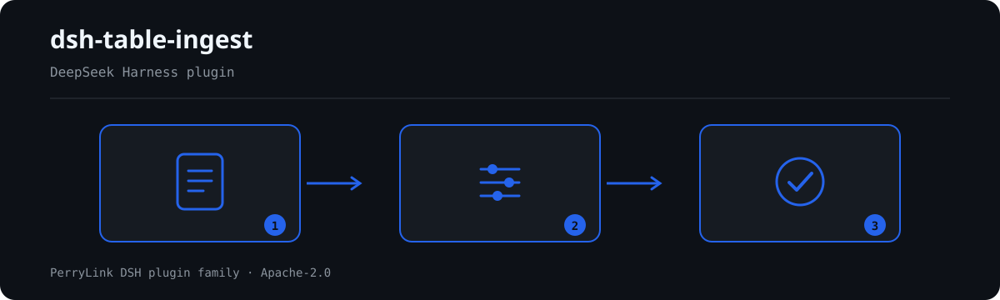

# dsh-table-ingest — Table ingest (Português)

[English](README.md) · [简体中文](README-zh.md) · [Español](README-es.md) · [Português](README-pt.md) · [हिन्दी](README-hi.md)

[](https://dshfind.com/en/plugins/PerryLink/dsh-table-ingest?ref=badge)

`dsh-table-ingest` converte um arquivo `.docx`, `.xlsx`, `.xlsm`, `.csv` ou `.tsv` no JSON de tabela que os verificadores de regras desta família consomem. Um verificador só consegue ler uma tabela que reconhece; documentos reais de escritório costumam ser arquivos Word com várias tabelas, células mescladas e uma linha de título acima do cabeçalho. Este pacote é o passo que transforma um no outro e — mais importante — avisa quando não conseguiu, em vez de adivinhar.

Não emite julgamento de negócio: não decide se um documento está em conformidade e não tem regras próprias; `rules/table-ingest.yaml` está vazio de propósito.

## Install

```sh
dsh plugin --profile <name> add dsh-table-ingest
dsh --profile <name> --dump-config | grep 'dsh-table-ingest'
```

## What it looks like



*Workflow overview: document → rule pack → findings.*

**Limite:** é um conversor, não um verificador. Nunca emite um achado, nunca pontua um documento e nunca grava no arquivo que leu. Quando um documento tem várias tabelas plausíveis, devolve os candidatos e pergunta qual você quis, porque uma tabela lida errada faz o verificador seguinte relatar diferenças que não existem — muito mais caro do que uma pergunta extra. Também não lê `.doc` binário, imagens digitalizadas nem PDF: isso exige um conversor ou OCR que esta família deliberadamente não carrega.

## What it answers

- Quais tabelas este documento realmente contém e qual o tamanho de cada uma?
- Qual linha é o cabeçalho e quais são os nomes das colunas?
- A tabela escolhida é confiável o suficiente para rodar regras, ou uma pessoa deve confirmar antes?
- Se não há tabela utilizável, é porque o documento não tem, ou porque precisa de OCR?

## Standards it follows

Este pacote não codifica nenhuma cláusula legal ou regulatória, portanto seu pacote de regras está vazio e não há diretório de evidências a citar. O que ele codifica é a estrutura OOXML de `word/document.xml` e `xl/worksheets/*.xml`:

- `<w:tbl>`, `<w:tr>`, `<w:tc>` para a estrutura; `<w:gridSpan>` para mesclagens horizontais e `<w:vMerge/>` (sem `w:val`) para "continuar a célula acima" — esta última fica *vazia* no XML, então preenchê-la para baixo é obrigatório ou um documento completo parece ter datas faltando.
- `<w:tblHeader>` com sombreamento e negrito como indícios de cabeçalho; o formato não define normativamente "linha de cabeçalho", então a detecção é uma heurística pontuada e o resultado é informado com um nível de confiança.
- `sharedStrings.xml` para strings compartilhadas (o `<v>` é um *índice*, não o valor), strings em linha (`t="inlineStr"`, cujo valor não está em `<v>`), e a indireção de três níveis `c@style` → `cellXfs` → `numFmtId` que decide se um número é uma data.

## Compatibility

| Surface | Status |
|---|---|
| Harness | peer range `>=0.1.2-rc.1 <0.2.0 \|\| >=0.2.0-0 <0.3.0` |
| Node | `^22.19.0 || >=24.0.0` |
| Platforms | all (pure ESM; no native code, no network, no model call) |

## What it does

There are no rules. The tool exposes one operation, `table_ingest`, which takes a file path and optional hints and returns `ok`, `tableIndex`, `headerRow`, `columns`, `rowCount`, `candidateCount`, `confidence` (`high` / `medium` / `low`), a markdown `preview` for confirmation, `tableJson` in the shape a rule checker accepts, plus `warnings` and `error`.

The chosen table is emitted in the same shape `parseTable` accepts, so a checker can consume it directly.

## Configuration

| Key | Default | Meaning |
|---|---|---|
| `rulesFile` | `rules/table-ingest.yaml` | 规则库路径 |

## Material format

A `.docx` with a title row, a header row and two data rows:

```
序号 | 日期        | 施工部位   | 监理情况
1    | 2026-10-08  | 1#楼三层   | 旁站检查…
2    | 2026-10-08  | 1#楼三层   | 旁站全过程…
```

becomes:

```json
{
  "target": "site-log.docx",
  "tableIndex": 0,
  "headerRows": [2],
  "columns": ["序号", "日期", "施工部位", "监理情况"],
  "header": {},
  "rows": [
    { "序号": "1", "日期": "2026-10-08", "施工部位": "1#楼三层", "监理情况": "旁站检查…" },
    { "序号": "2", "日期": "2026-10-08", "施工部位": "1#楼三层", "监理情况": "旁站全过程…" }
  ],
  "warnings": ["1 个单元格为空，已从上方合并单元格补值"],
  "mergedCells": 1,
  "sections": [],
  "ragged": false
}
```

For `.csv` and `.tsv` the same shape is produced with `headerRows: [1]`.

## Rule sources

This package cites no clause, so it has no `rules/evidence/` directory and its rule pack is empty by design. Confirm that with `pnpm run check:citations` (expects 0 segments, 0 placeholders, 0 untraceable).

Known limits, stated rather than hidden: header detection is a heuristic scored over the first six rows; two-level headers are not merged by default because merging breaks the alias matching downstream; a ragged table is reported, not repaired; and `expectedColumns` is the strongest signal a caller can supply.

## Troubleshooting

- **The plugin installs but the tool never appears**: check that `main` resolves to `lib/index.mjs` and that `pnpm run build` produced it.
- **`dsh plugin add` rejects the package**: the peer range covers `0.1.x` and `0.2.x`; outside it, grant an explicit exemption.
- **A rule did not run**: read the `skipped` array.

## Development

```sh
pnpm install
pnpm run typecheck
pnpm test
pnpm run build
node ../scripts/sync-shared.mjs dsh-table-ingest
```

## PerryLink DSH Plugin Family

Full family index: [choose a checker by material](https://perrylink.github.io/zh/checkers/choose/) and [all plugins](https://github.com/PerryLink). This repository is one of them.

## License

[Apache License 2.0](LICENSE) © 2026 dsh-table-ingest contributors.
