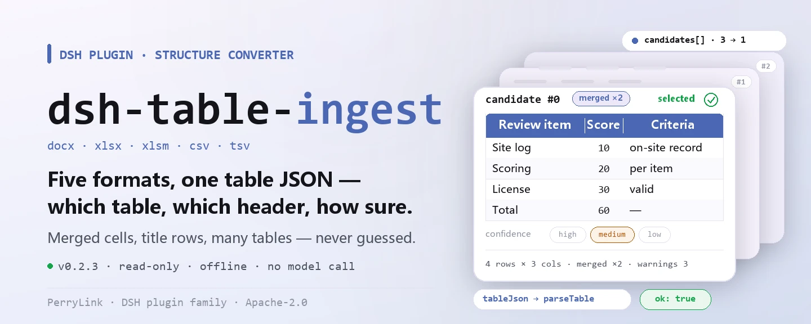
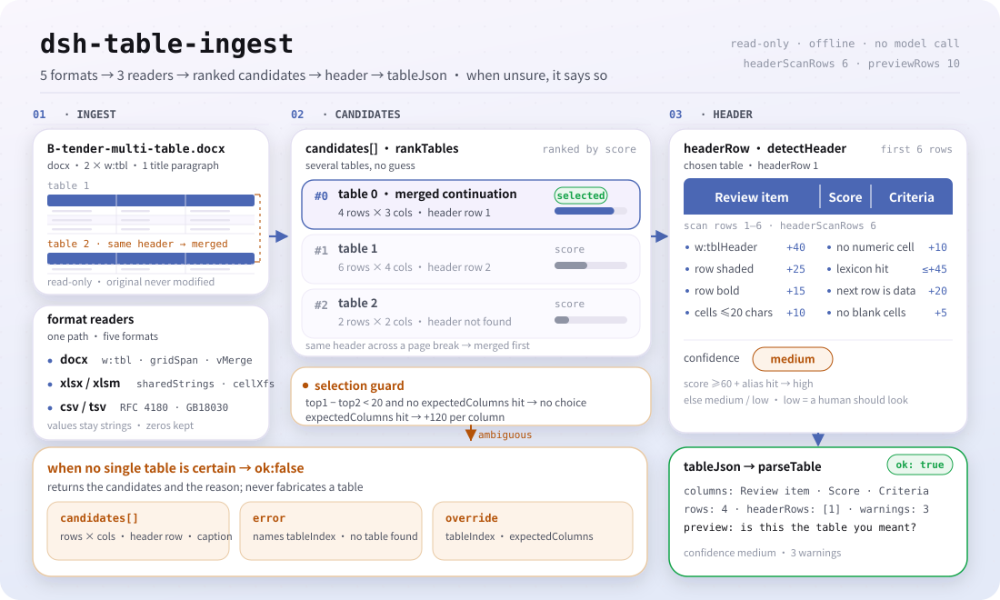

<div align="center">

<picture>
  <source media="(prefers-color-scheme: dark)" srcset="docs/assets/dsh-table-ingest-hero-en-dark.webp">
  
</picture>

# dsh-table-ingest

**Turn docx, xlsx and csv files into the table JSON a rule checker can consume — and say which table it picked, and whether it is sure.**

A structural converter for DeepSeek Harness: several tables in one Word file, merged cells, a title row above the header — it reads all of that into column names, rows and a confidence level, and when it cannot, it says so instead of guessing.

[Install](#three-step-setup) · [Configuration](#configuration) · [FAQ](#faq) · [简体中文](README.md) · [English](README.en.md)

[](LICENSE)
[](#compatibility)
[](https://www.npmjs.com/package/dsh-table-ingest)
[](https://github.com/PerryLink/dsh-table-ingest/actions/workflows/ci.yml)
[](#compatibility)

[](https://github.com/PerryLink/dsh-table-ingest/stargazers)
[](https://www.npmjs.com/package/dsh-table-ingest)
[](https://dshfind.com/plugins/PerryLink/dsh-table-ingest?ref=badge)
[](https://securityscorecards.dev/viewer/?uri=github.com/PerryLink/dsh-table-ingest)

```sh
dsh plugin --profile <name> add dsh-table-ingest
```

</div>

<sub>Community plugin, not affiliated with DeepSeek. Canonical repository: <https://github.com/PerryLink/dsh-table-ingest>.</sub>

## What it is

`dsh-table-ingest` converts `.docx`, `.xlsx`, `.xlsm`, `.csv` and `.tsv` files into the table JSON this family's rule checkers consume. A checker can only read a table it can recognise, and most real workplace documents are Word files with several tables, merged cells and a title row above the header. This package is that one step — and, more importantly, **when it cannot convert, it says so instead of guessing**.

It performs no business judgement: it does not decide whether a document is compliant, it assigns no liability, and it has no rules of its own — `rules/table-ingest.yaml` is deliberately empty.

- **Who it is for**: staff who need to push tabular material into a rule check; no command line required, hand it the file in the conversation.
- **What you give it**: the local path of one `.docx` / `.xlsx` / `.xlsm` / `.csv` / `.tsv` file. The original is never modified.
- **What it gives back**: table JSON, column names and size with a confidence level, and a preview table for a human eye; when it cannot find a table, the candidate list and the reason.

<picture>
  <source media="(prefers-color-scheme: dark)" srcset="docs/assets/dsh-table-ingest-flow-v5-dark.svg">
  
</picture>

## Three-step setup

1. **Install** (pick one channel):

   ```sh
   # git channel (latest main; equivalent to git+https://github.com/PerryLink/dsh-table-ingest.git)
   dsh plugin --profile <name> add github:PerryLink/dsh-table-ingest
   # npm channel (published releases)
   dsh plugin --profile <name> add dsh-table-ingest
   # tarball channel: pnpm pack in this repo, then
   dsh plugin --profile <name> add ./dsh-table-ingest-<version>.tgz
   ```

2. **Minimal config** (the defaults are usable; a bundle row without `config` runs on them):

   ```yaml
   - insert:
       - id: dsh-table-ingest
         name: dsh-table-ingest
   ```

3. **Verify it mounted**:

   ```sh
   dsh --profile <name> --dump-config | grep 'dsh-table-ingest'
   ```

   Then hand it a file. With the bundled sample (run `pnpm run build` first so `lib/` exists) the run prints a four-line summary, and the full JSON it produces is reproduced in [Examples](#examples).

   ```sh
   $ node samples/quickstart/run.mjs
   table_ingest: docx, ok, 4 rows x 3 columns, confidence medium
   ```

   *Observed from `docs/assets/quickstart.log`; `samples/quickstart/expected/result.json`*

**Uninstall**: `dsh plugin --profile <name> remove dsh-table-ingest` (or remove the row from the profile patch).

## Core capabilities

`dsh-table-ingest` registers the `table_ingest` tool: it reads one file, picks one table, returns table JSON the downstream checker can consume, and states the evidence behind every decision.

- **Five formats, one pipeline** — `.docx`, `.xlsx`, `.xlsm`, `.csv` and `.tsv` all go through the same stages (select table → detect header → preview → table JSON). CSV/TSV support RFC 4180 quoting and delimiter sniffing, and fall back to GB18030 when the bytes are not valid UTF-8 — the encoding Chinese CSVs exported from Excel on Windows usually have, where a straight UTF-8 decode turns every column name into replacement characters.
- **Several tables, no guessing** — when more than one table is equally plausible it returns the candidates with their sizes and asks you to pick with `tableIndex`; `expectedColumns` is the strongest signal and turns an ambiguous document into a deterministic choice.
- **Header detection with a confidence level** — it scores bold, shading, `tblHeader`, short text, absence of digits and a small vocabulary over the first `headerScanRows` rows (6 by default), and labels the result `high` / `medium` / `low`; `low` means "a human should look at this".
- **Merged cells filled, not dropped** — `w:gridSpan` expands horizontally, `w:vMerge` (without `w:val`) continues the cell above, a table that continues across a page break is merged by its header, and a full-width merged row is skipped as a group label; every one of those steps is reported in `warnings`.
- **A wrong table costs more than no table** — the preview closes with "is this the table you meant?" and never says "converted successfully"; a missing table, an undetectable header and a ragged row count all show up in `error` and `warnings`.
- **Read-only, offline** — it reads the one file you give it, never writes it back, is pure ESM, and makes no network request and no model call.
- **Library entry** — `dsh-table-ingest/api` exposes the same conversion as plain functions (`ingestToTable`, `readWorkbook`, `readDelimited`, `serialToDate`, …), so another package needs neither the tool registration nor a second copy of the OOXML readers.

### What it answers

- Which tables does this document actually contain, and how big is each one?
- Which row is the header, and what are the column names?
- Is the chosen table reliable enough to run rules against, or should a human confirm first?
- If there is no usable table, is that because the document has none, or because it needs OCR?

### Tool surface

Every `table_ingest` argument is optional: leaving them out means "decide for yourself and tell me what you decided", which is the common case; supplying one overrides the heuristic rather than merely biasing it.

| Argument | Type | Default | Meaning |
|---|---|---|---|
| `file` | string | required | Absolute path (`.docx` / `.xlsx` / `.xlsm` / `.csv` / `.tsv`) |
| `tableIndex` | number | empty = auto | Which table to take (0-based); on ambiguity the tool returns candidates instead of guessing |
| `headerRow` | number | empty = layout signal | Which row is the header (1-based) |
| `expectedColumns` | string[] | `[]` | Expected column names; the primary signal for both table and header selection |
| `captionKeywords` | string[] | `[]` | Keywords the table caption may contain, e.g. "site log" or "scoring" |
| `previewRows` | number | config `previewRows` | How many data rows the preview returns |

### Output fields

| Field | Meaning |
|---|---|
| `ok` | Whether a single table could be identified with enough confidence |
| `tableIndex`, `headerRow`, `columns` | What was chosen |
| `rowCount`, `candidateCount` | How much was read, and how many tables were found |
| `confidence` | `high`, `medium` or `low` — `low` means "a human should look at this" |
| `preview` | A markdown table of the first rows, for confirmation |
| `tableJson` | The table in the shape a rule checker accepts |
| `warnings`, `error` | What was odd, or why no table was chosen |

The chosen table is emitted in the same shape `parseTable` accepts, so a checker can consume it directly.

### Examples

These are the plugin's real entry points; install once, then call one.

**Detailed example** — tool `table_ingest`, target `samples/quickstart/input/B-tender-multi-table.docx` (a scoring table split across two pages); the full text of `samples/quickstart/expected/result.json`:

```json
{
  "tool": "table_ingest",
  "format": "docx",
  "ok": true,
  "confidence": "medium",
  "tableIndex": 0,
  "headerRow": 1,
  "columns": [
    "评审因素",
    "分值",
    "评分标准"
  ],
  "rowCount": 4,
  "candidateCount": 1,
  "warnings": [
    "与第 2 张表表头相同，已按跨页续表合并",
    "第 3 行是整行合并的分组行「服务部分」，已跳过（未作为数据行）",
    "第 2 张表与上一张表表头相同，已合并为一张"
  ]
}
```

The three `warnings` say what it did: a continuation across a page break was merged by header, a full-width merged group row was skipped as a label, and two tables sharing one header became one — none of it silent.

*Observed from `samples/quickstart/expected/result.json`; `src/ingest/table-json.ts`*

**Failure branch** — tool `table_ingest` reading `C-hedui-baogao.docx` (several tables are equally plausible): the result is `ok: false`, `error` names `tableIndex`, `candidates` lists each candidate's row and column counts, header row and caption, and the markdown closes by telling you to name one of them with `tableIndex` and retry. Supplying `expectedColumns` with the column names you expect makes the same document resolve deterministically.

*Observed from `tests/index.test.ts:63-79`; `src/view.ts:84-100`*

**Short examples**: `node samples/quickstart/run.mjs --json` · `node samples/quickstart/run.mjs --check`

## The standard it encodes

This package encodes no legal or regulatory clause, so its rule pack is empty and there is no evidence directory to cite. What it does encode is the OOXML structure of `word/document.xml` and `xl/worksheets/*.xml`:

- `<w:tbl>`, `<w:tr>`, `<w:tc>` for table structure; `<w:gridSpan>` for horizontal merges and `<w:vMerge/>` (no `w:val`) for "continue the cell above" — the latter is *empty* in the XML, so filling it down is required or a complete document looks like it is missing dates.
- `<w:tblHeader>` plus shading and bold as header hints; there is no normative definition of "header row" in the format, so header detection is a scored heuristic and its result is reported with a confidence level.
- `sharedStrings.xml` for shared strings (the `<v>` is an *index*, not the value), inline strings (`t="inlineStr"`, whose value is not in `<v>`), and the three-level indirection from `c@style` → `cellXfs` → `numFmtId` that decides whether a number is a date.

### The rule pack is empty

This package cites no clause, so it has no `rules/evidence/` directory and its rule pack is empty by design. Confirm that with:

```sh
pnpm run check:citations   # expects 0 segments, 0 placeholders, 0 untraceable
```

The reason `rules/table-ingest.yaml` is kept rather than deleted is written in the file header: the family's package layout gives every package a `rules/<pack>.yaml` that the tooling locates, and keeping rules apart from data is what lets a downstream rule pack consume this package's output. Adding a "material structure" rule here later (for example "this table must have a header") means appending to that file in the same format as every other rule pack.

## Material format

A `.docx` with a title row, a header row and two data rows:

```
序号 | 日期        | 施工部位   | 监理情况
1    | 2026-10-08  | 1#楼三层   | 旁站检查…
2    | 2026-10-08  | 1#楼三层   | 旁站全过程…
```

becomes:

```json
{
  "target": "site-log.docx",
  "tableIndex": 0,
  "headerRows": [2],
  "columns": ["序号", "日期", "施工部位", "监理情况"],
  "header": {},
  "rows": [
    { "序号": "1", "日期": "2026-10-08", "施工部位": "1#楼三层", "监理情况": "旁站检查…" },
    { "序号": "2", "日期": "2026-10-08", "施工部位": "1#楼三层", "监理情况": "旁站全过程…" }
  ],
  "warnings": ["1 个单元格为空，已从上方合并单元格补值"],
  "mergedCells": 1,
  "sections": [],
  "ragged": false
}
```

`.csv` and `.tsv` produce the same shape with `headerRows: [1]`. Every value stays a string, so a leading zero survives.

## Configuration

Every tunable is a Schemastery `Config` field in `src/config.ts` (overridable from cordis.yml). An override by id replaces the whole row — restate every key you need. This package is a converter, not a rule checker, so there are no rule switches, only the heuristics' ceilings and the tool timeout:

| Key | Type | Default | Meaning |
|---|---|---|---|
| `timeoutMs` | number | `60000` | Tool timeout budget in milliseconds |
| `headerScanRows` | number | `6` | How many rows down to scan for the header; a header below that is reported as "no header" |
| `previewRows` | number | `10` | How many data rows the confirmation preview returns by default |

Profile patch override example:

```yaml
- insert:
    - id: dsh-table-ingest
      name: dsh-table-ingest
      config:
        headerScanRows: 10
        previewRows: 20
        timeoutMs: 180000
```

## FAQ

<details>
<summary>Is my file uploaded? Does it phone home?</summary>

No. It reads the one local file you hand it, makes no network request, calls no model, never writes the original back and keeps no second copy (`package.json#dsh.demo` declares `network: false`, `writes: []`, and a single read (the .docx file to be extracted)). The result exists only in the return value of that one tool call.

</details>

<details>
<summary>With several tables, will it quietly pick one for me?</summary>

No. When two or more tables score closely on the same signals it lists the candidates with their row/column counts and header positions, sets `ok` to `false`, and asks you to name one with `tableIndex`; `expectedColumns` usually settles it in one shot and is the single most effective argument. The table it did pick comes with a preview that closes with "is this the table you meant?", because it never claims a conversion succeeded.

</details>

<details>
<summary>My table has a title row above the header, or the header sits far down. What then?</summary>

Header detection only looks at the first `headerScanRows` rows (6 by default); anything below is reported as "no header" rather than searched for indefinitely. That is deliberate: treating body text as a header makes every downstream rule misfire. For such documents, name the row explicitly with `headerRow` (1-based). Two-level headers are deliberately not merged either — see Known limitations.

</details>

<details>
<summary>Can a hostile docx someone sent me blow up memory?</summary>

Since 0.2.1 there are hard ceilings: a package is rejected before decompression when it declares more than 256 entries, an entry name over 4 KiB, or a compressed entry over 8 MiB; deflate output is bounded per entry (8 MiB) and cumulatively (32 MiB) via `inflateRawSync({ maxOutputLength })`, so a valid but hostile deflate stream cannot expand without limit. These are security ceilings, not tunables.

</details>

<details>
<summary>Does it have rules of its own? Can it judge compliance?</summary>

No, and no. `rules` in `rules/table-ingest.yaml` is an empty array — this package only converts structure, and never produces a finding, a score or a liability call. To judge compliance, hand its `tableJson` to a real rule pack (the family's 62 checkers).

</details>

## Troubleshooting

- **The plugin installs but the tool never appears.** Check that `main` resolves to `lib/index.mjs` and that `pnpm run build` produced it; a wrong `main` makes the loader skip the row silently.
- **`dsh plugin add` rejects the package as incompatible.** `engines.dsh` here is `>=0.2.1-0 <0.3.0`, and the peer range covers `0.1.x` and `0.2.x`; outside it, grant an explicit exemption.
- **The table came back without a header, or clearly picked the wrong header row.** Name it with `headerRow` (1-based) or raise `headerScanRows`; `confidence: low` is exactly the "a human should look" signal.
- **A downstream rule did not run.** Read that report's `skipped` array — this package only feeds the table, rules run in the downstream pack; a misread table makes the downstream report differences that do not exist, so check `ok` and the preview first.
- **A four-table document always ends up asking.** Pass `expectedColumns`; the ambiguity becomes a deterministic choice.

## Security boundaries

- **ZIP ceilings** (since 0.2.1). DOCX/XLSX input is untrusted: a package is rejected before decompression when it declares more than 256 entries, an entry name over 4 KiB, or a compressed entry over 8 MiB; deflate output is bounded per entry (8 MiB) and cumulatively (32 MiB).
- **Directory bounds.** Name, extra, comment and local-header lengths are checked against the buffer before reading; a truncated directory or a local offset outside the package raises `ZipError` instead of returning partial data.
- **Read-only.** It never writes back the file it read and creates no copy; no state is shared between calls (`isConcurrencySafe: () => true`).
- **Failure is visible.** When no table can be identified the result is `ok: false` + `error` + the candidate list, never a fabricated one-column table — "one column of text" would be accepted by no downstream column alias, so reporting "no table found" is the honest answer.
- **No business judgement.** No rules, no score, no compliance verdict; `rules/table-ingest.yaml` is an empty pack and `check:citations` expects 0 segments / 0 placeholders / 0 untraceable.
- **No network, no model call, no native code.** Pure ESM, pure local string and byte processing.

## Permissions & data

- **Permissions**: the manifest declares `tools:register` only; `package.json#dsh.demo` lists one read (the .docx file to be extracted), no writes and `network: false`.
- **Data**: nothing is written to disk, uploaded, or duplicated; the conversion exists only in the return value of that one call.
- **Session log**: the result text is recorded in the session by the host (host behaviour); this plugin declares and appends no session event type of its own.
- **Privacy**: [`PRIVACY.md`](PRIVACY.md) covers the npm package itself, not the DSH host or any other plugin in the profile.

## Known limitations

- **Header detection is a heuristic.** It scores bold, shading, `tblHeader`, short text, absence of digits and a small vocabulary over the first six rows. A header further down is reported as "no header" rather than searched for indefinitely.
- **Two-level headers are not merged by default.** Merging them breaks the alias matching downstream (an amount column titled `amount (yuan)/total` is not the alias `total`), so the most specific row is used, and the parent label is only prefixed when a child name repeats.
- **A ragged table is reported, not repaired.** When a row's cells do not add up to the declared width, the result is marked `ragged` and `low` confidence; there is no information in the file to recover the author's intent.
- **`expectedColumns` is the strongest signal you can give.** Supplying it turns an ambiguous four-table document into a deterministic choice.
- **`.doc` (BIFF), scanned images and PDFs are not read.** Those need a converter or OCR that this family deliberately does not carry; the binary `.doc` and `.xls` formats are outside the supported surface too.
- **The rule pack is empty.** This package cites no clause and has no `rules/evidence/` directory — a compliance verdict is not its job.

## Interoperability with other DSH plugins

- **One tool, registered once.** The tool id is `table_ingest`, with `inject: ['tools']` — without a `tools` service the plugin does not load at all, so it never half-starts.
- **No service key, no slot, no HTTP route.** It provides no service key, registers no client slot key, registers no `webServer` prefix, and does not patch prototypes, rewrite `process.env` or replace the global fetch dispatcher.
- **The bundle patch only `insert`s its own row.** `cordis.patch.yml` never overrides a built-in row's `config`, so it cannot collide with another patching plugin.
- **Registration is an effect.** `ctx.tools.register` returns the disposer, so hot reload and unload remove the tool.
- **The output lines up with the consumer.** The table JSON has the shape `parseTable` accepts, and a test asserts "produces table JSON the engine can consume", so this family's rule packs consume it directly with no adapter.

## Compatibility

| Surface | Status |
|---|---|
| Harness | `engines.dsh` is `>=0.2.1-0 <0.3.0`; peer range `>=0.1.2-rc.1 <0.2.0 \|\| >=0.2.0-0 <0.3.0` (covers both the 0.1.x and 0.2.x lines) |
| Node | `^22.19.0 \|\| >=24.0.0` |
| Platforms | All (pure ESM; no native code, no network, no model call) |
| Input formats | `.docx`, `.xlsx`, `.xlsm`, `.csv`, `.tsv`; no `.doc` (BIFF), no scans, no PDF |

## Ecosystem & quality

- [npm package page](https://www.npmjs.com/package/dsh-table-ingest) (version, downloads, dependencies)
- [dshfind plugin page](https://dshfind.com/plugins/PerryLink/dsh-table-ingest) (installs and ranking)
- [OpenSSF Scorecard report](https://securityscorecards.dev/viewer/?uri=github.com/PerryLink/dsh-table-ingest) (driven by [.github/workflows/scorecard.yml](.github/workflows/scorecard.yml))
- [Choose a checker by material](https://perrylink.github.io/zh/checkers/choose/) (the full index of 62 checkers; this package is their upstream)
- [Ecosystem knowledge base](https://perrylink.github.io/dsh-plugin-guide/): plugin development guide · selection data · maintenance criteria
- [All PerryLink plugins](https://github.com/PerryLink) (family overview)

## Development

```sh
pnpm install                                       # node ^22.19 || >=24
pnpm run typecheck                                 # tsc --noEmit
pnpm test                                          # vitest run: contract + boundary semantics + ZIP ceilings
pnpm run build                                     # tsdown -> lib/index.mjs + lib/index.d.mts
pnpm run verify:self-contained                     # dependency specs resolve from the registry
pnpm run check:lockfile                            # lockfile drift check
pnpm run check:readmes                             # five-language README consistency
pnpm run check:citations                           # rule-pack citation baseline
node ../scripts/sync-shared.mjs dsh-table-ingest   # refresh src/shared from ../_shared
pnpm pack                                          # the published tarball
```

The acceptance record is in [`ACCEPTANCE.csv`](ACCEPTANCE.csv) (`npx vitest run`, 25/25 passing, source public/synthetic). The sample run needs `pnpm run build` first:

```sh
node samples/quickstart/run.mjs           # human-readable summary
node samples/quickstart/run.mjs --json    # the same summary as JSON
node samples/quickstart/run.mjs --check   # compare against expected/result.json
```

The sample input is in `samples/quickstart/input/` and the gold output in `samples/quickstart/expected/result.json`; the real run's screenshot and terminal text are `docs/assets/quickstart.png` and `docs/assets/quickstart.log`.

Directory layout:

| Path | Contents |
|---|---|
| `src/index.ts` | Plugin entry: `name` / `inject` / `Config` / `apply`, registers `table_ingest` |
| `src/config.ts` | Schemastery config schema (every tunable lives here) |
| `src/ingest/` | Format readers: `docx.ts`, `xlsx.ts`, `csv.ts`, `zip.ts`, `xml.ts`, plus the selection/header pipeline `ingest.ts`, `table-json.ts` |
| `src/view.ts` | Model-facing projection: the `markdown` summary, the preview and the candidate wording |
| `src/api.ts` | Library entry `dsh-table-ingest/api` |
| `src/shared/` | Vendored shared kit (table helpers, ruleset, YAML subset, date arithmetic, wording guard) |
| `rules/table-ingest.yaml` | The empty rule pack (structural convention, see "The rule pack is empty") |
| `tests/` | vitest: contract, boundary semantics, ZIP ceilings; `fixtures/` holds real synthetic docx/xlsx/csv files |
| `samples/quickstart/` | A re-runnable sample and its gold output |
| `docs/assets/` | Images and the real terminal output |

The README images are generated programmatically by [`scripts/gen-readme-assets.py`](scripts/gen-readme-assets.py) — the hero banner with Pillow, the flow-v5 structure diagram as hand-written SVG — and are safe to re-run: `python scripts/gen-readme-assets.py`. The older single-skin diagram and demo stay in `docs/assets/` for external deep links; the READMEs reference only the new hero and flow-v5, each in light and dark.

Topics: `deepseek-harness`, `dsh`, `dsh-plugin`, `cordis`, `ingest`, `docx`, `xlsx`, `csv`, `table`

## Family & thanks

This project is part of the DeepSeek Harness plugin family from [PerryLink](https://github.com/PerryLink) (all Apache-2.0). The full family index is [choose a checker by material](https://perrylink.github.io/zh/checkers/choose/); this package is the conversion layer upstream of those 62 checkers. If it is useful, **a star helps the next person find it** — nothing is gated behind it.

- [@PerryLink](https://github.com/PerryLink) — creator and maintainer: the OOXML and delimited readers, the table-selection and header heuristics, the `table_ingest` tool, the `dsh-table-ingest/api` library entry, and the five-language docs.

## License

[LICENSE](LICENSE) (Apache License 2.0) © 2026 dsh-table-ingest contributors

<p align="center"><sub>Apache-2.0 · community plugin, not affiliated with DeepSeek.</sub></p>
