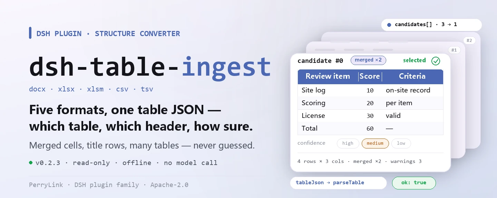
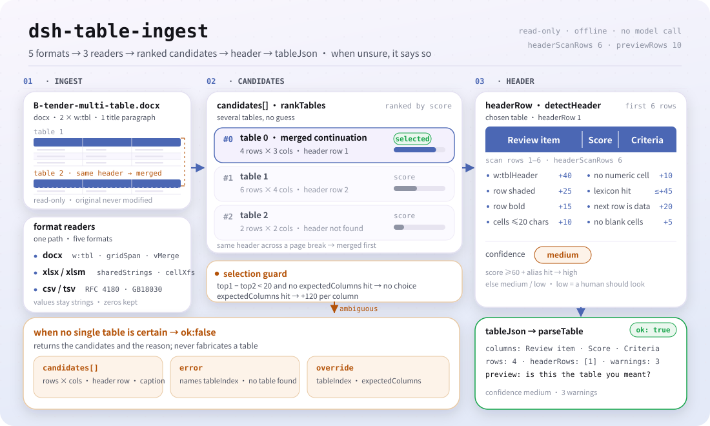

<div align="center">

<picture>
  <source media="(prefers-color-scheme: dark)" srcset="docs/assets/dsh-table-ingest-hero-en-dark.webp">
  
</picture>

# dsh-table-ingest

**Convierte docx, xlsx y csv en el JSON de tabla que un verificador de reglas puede consumir, y dice qué tabla eligió y si está seguro.**

Un conversor estructural para DeepSeek Harness: varias tablas en un mismo Word, celdas combinadas, una fila de título encima del encabezado — todo eso se lee como nombres de columna, filas y un nivel de confianza; y cuando no puede, lo dice en lugar de adivinar.

[Instalar](#instalación-en-tres-pasos) · [Configuración](#configuración) · [FAQ](#faq) · [简体中文](README.md) · [English](README.en.md) · [Español](README.es.md) · [Português](README.pt.md) · [हिन्दी](README.hi.md)

[](LICENSE)
[](#compatibilidad)
[](https://www.npmjs.com/package/dsh-table-ingest)
[](https://github.com/PerryLink/dsh-table-ingest/actions/workflows/ci.yml)
[](#compatibilidad)

[](https://github.com/PerryLink/dsh-table-ingest/stargazers)
[](https://www.npmjs.com/package/dsh-table-ingest)
[](https://dshfind.com/plugins/PerryLink/dsh-table-ingest?ref=badge)
[](https://securityscorecards.dev/viewer/?uri=github.com/PerryLink/dsh-table-ingest)

```sh
dsh plugin --profile <name> add dsh-table-ingest
```

</div>

<sub>Plugin de la comunidad, no afiliado a DeepSeek. Repositorio canónico: <https://github.com/PerryLink/dsh-table-ingest>.</sub>

## Qué es

`dsh-table-ingest` convierte archivos `.docx`, `.xlsx`, `.xlsm`, `.csv` y `.tsv` en el JSON de tabla que consumen los verificadores de reglas de esta familia. Un verificador solo puede leer una tabla que reconoce, y los documentos reales de oficina suelen ser archivos Word con varias tablas, celdas combinadas y una fila de título encima del encabezado. Este paquete es ese paso —y, más importante, **cuando no puede convertir lo dice, en lugar de adivinar**.

No emite ningún juicio de negocio: no decide si un documento cumple, no atribuye responsabilidad y no tiene reglas propias; `rules/table-ingest.yaml` está vacío a propósito.

- **Para quién**: personal que necesita llevar material tabular a una verificación de reglas; no hace falta la línea de comandos, basta entregar el archivo en la conversación.
- **Qué entregas**: la ruta local de un archivo `.docx` / `.xlsx` / `.xlsm` / `.csv` / `.tsv`. El original nunca se modifica.
- **Qué devuelve**: el JSON de tabla, los nombres de columna y el tamaño con un nivel de confianza, y una tabla de vista previa para el ojo humano; cuando no encuentra tabla, la lista de candidatas y el motivo.

<picture>
  <source media="(prefers-color-scheme: dark)" srcset="docs/assets/dsh-table-ingest-flow-v5-dark.svg">
  
</picture>

## Instalación en tres pasos

1. **Instalar** (elige un canal):

   ```sh
   # canal git (main más reciente; equivale a git+https://github.com/PerryLink/dsh-table-ingest.git)
   dsh plugin --profile <name> add github:PerryLink/dsh-table-ingest
   # canal npm (versiones publicadas)
   dsh plugin --profile <name> add dsh-table-ingest
   # canal tarball: pnpm pack en este repositorio y luego
   dsh plugin --profile <name> add ./dsh-table-ingest-<version>.tgz
   ```

2. **Configuración mínima** (los valores por defecto ya sirven; una fila de bundle sin `config` funciona con ellos):

   ```yaml
   - insert:
       - id: dsh-table-ingest
         name: dsh-table-ingest
   ```

3. **Verificar que quedó activo**:

   ```sh
   dsh --profile <name> --dump-config | grep 'dsh-table-ingest'
   ```

   Luego entrégale un archivo. Con la muestra incluida (ejecuta antes `pnpm run build` para que exista `lib/`) la corrida imprime un resumen de cuatro líneas, y el JSON completo que produce está reproducido en [Ejemplos](#ejemplos).

   ```sh
   $ node samples/quickstart/run.mjs
   table_ingest: docx, ok, 4 rows x 3 columns, confidence medium
   ```

   *Observed from `docs/assets/quickstart.log`; `samples/quickstart/expected/result.json`*

**Desinstalar**: `dsh plugin --profile <name> remove dsh-table-ingest` (o borra la fila del patch del profile).

## Capacidades clave

`dsh-table-ingest` registra la herramienta `table_ingest`: lee un archivo, elige una tabla, devuelve el JSON de tabla que el verificador posterior puede consumir y declara la evidencia de cada decisión.

- **Cinco formatos, una tubería** — `.docx`, `.xlsx`, `.xlsm`, `.csv` y `.tsv` pasan por las mismas etapas (elegir tabla → detectar encabezado → vista previa → JSON de tabla). CSV/TSV admiten comillas RFC 4180 y detección de delimitador, y recurren a GB18030 cuando los bytes no son UTF-8 válido: la codificación habitual de los CSV chinos exportados desde Excel en Windows, donde una decodificación UTF-8 directa convierte cada nombre de columna en caracteres de reemplazo.
- **Varias tablas, sin adivinar** — cuando más de una tabla es igual de plausible devuelve las candidatas con su tamaño y pide que elijas con `tableIndex`; `expectedColumns` es la señal más fuerte y convierte un documento ambiguo en una elección determinista.
- **Detección de encabezado con nivel de confianza** — puntúa negrita, sombreado, `tblHeader`, texto corto, ausencia de dígitos y un vocabulario reducido sobre las primeras `headerScanRows` filas (6 por defecto), y etiqueta el resultado como `high` / `medium` / `low`; `low` significa «alguien debería mirarlo».
- **Celdas combinadas rellenadas, no descartadas** — `w:gridSpan` se expande horizontalmente, `w:vMerge` (sin `w:val`) continúa la celda superior, una tabla que sigue en otra página se fusiona por su encabezado y una fila combinada de ancho completo se omite como etiqueta de grupo; cada uno de esos pasos se informa en `warnings`.
- **Una tabla equivocada cuesta más que ninguna** — la vista previa cierra con «¿es esta la tabla que buscabas?» y nunca dice «conversión exitosa»; una tabla inexistente, un encabezado indetectable y un recuento de celdas irregular aparecen en `error` y `warnings`.
- **Solo lectura y sin red** — lee el único archivo que le das, nunca lo reescribe, es ESM puro y no hace peticiones de red ni llamadas al modelo.
- **Entrada de biblioteca** — `dsh-table-ingest/api` expone la misma conversión como funciones normales (`ingestToTable`, `readWorkbook`, `readDelimited`, `serialToDate`, …), así que otro paquete no necesita el registro de la herramienta ni una segunda copia de los lectores OOXML.

### Qué responde

- ¿Qué tablas contiene realmente este documento y de qué tamaño es cada una?
- ¿Qué fila es el encabezado y cuáles son los nombres de columna?
- ¿La tabla elegida es lo bastante fiable para ejecutar reglas, o conviene que una persona confirme?
- Si no hay tabla utilizable, ¿es porque el documento no tiene, o porque necesita OCR?

### Superficie de la herramienta

Todos los argumentos de `table_ingest` son opcionales: dejarlos vacíos significa «decide tú y dime qué decidiste», que es el caso habitual; dar uno sustituye a la heurística en lugar de solo inclinarla.

| Argumento | Tipo | Por defecto | Significado |
|---|---|---|---|
| `file` | string | obligatorio | Ruta absoluta (`.docx` / `.xlsx` / `.xlsm` / `.csv` / `.tsv`) |
| `tableIndex` | number | vacío = automático | Qué tabla tomar (base 0); ante ambigüedad devuelve candidatas en lugar de adivinar |
| `headerRow` | number | vacío = señal de maquetación | Qué fila es el encabezado (base 1) |
| `expectedColumns` | string[] | `[]` | Nombres de columna esperados; señal principal para elegir tabla y encabezado |
| `captionKeywords` | string[] | `[]` | Palabras que puede contener el título de la tabla, p. ej. «registro de obra» o «puntuación» |
| `previewRows` | number | `previewRows` de la config | Cuántas filas de datos devuelve la vista previa |

### Campos de salida

| Campo | Significado |
|---|---|
| `ok` | Si se pudo identificar una única tabla con confianza suficiente |
| `tableIndex`, `headerRow`, `columns` | Qué se eligió |
| `rowCount`, `candidateCount` | Cuánto se leyó y cuántas tablas se encontraron |
| `confidence` | `high`, `medium` o `low` — `low` significa «alguien debería mirarlo» |
| `preview` | Una tabla markdown con las primeras filas, para confirmar |
| `tableJson` | La tabla con la forma que acepta un verificador de reglas |
| `warnings`, `error` | Qué resultó extraño, o por qué no se eligió ninguna tabla |

La tabla elegida se emite con la misma forma que acepta `parseTable`, así que un verificador puede consumirla directamente.

### Ejemplos

Estos son los puntos de entrada reales del plugin; instala una vez y llama a uno.

**Ejemplo detallado** — herramienta `table_ingest`, objetivo `samples/quickstart/input/B-tender-multi-table.docx` (una tabla de puntuación partida en dos páginas); el texto completo de `samples/quickstart/expected/result.json`:

```json
{
  "tool": "table_ingest",
  "format": "docx",
  "ok": true,
  "confidence": "medium",
  "tableIndex": 0,
  "headerRow": 1,
  "columns": [
    "评审因素",
    "分值",
    "评分标准"
  ],
  "rowCount": 4,
  "candidateCount": 1,
  "warnings": [
    "与第 2 张表表头相同，已按跨页续表合并",
    "第 3 行是整行合并的分组行「服务部分」，已跳过（未作为数据行）",
    "第 2 张表与上一张表表头相同，已合并为一张"
  ]
}
```

Los tres `warnings` dicen qué hizo: una continuación entre páginas se fusionó por encabezado, una fila de grupo combinada de ancho completo se omitió como etiqueta y dos tablas con el mismo encabezado pasaron a ser una; nada de eso ocurre en silencio.

*Observed from `samples/quickstart/expected/result.json`; `src/ingest/table-json.ts`*

**Rama de fallo** — la herramienta `table_ingest` leyendo `C-hedui-baogao.docx` (varias tablas igual de plausibles): el resultado es `ok: false`, `error` nombra `tableIndex`, `candidates` lista las filas y columnas de cada candidata, su fila de encabezado y su título, y el markdown termina pidiendo que nombres una de ellas con `tableIndex` y reintentes. Si aportas `expectedColumns` con los nombres de columna que esperas, el mismo documento se resuelve de forma determinista.

*Observed from `tests/index.test.ts:63-79`; `src/view.ts:84-100`*

**Ejemplos breves**: `node samples/quickstart/run.mjs --json` · `node samples/quickstart/run.mjs --check`

## El estándar que codifica

Este paquete no codifica ninguna cláusula legal ni reglamentaria, por lo que su paquete de reglas está vacío y no hay directorio de evidencia que citar. Lo que sí codifica es la estructura OOXML de `word/document.xml` y `xl/worksheets/*.xml`:

- `<w:tbl>`, `<w:tr>`, `<w:tc>` para la estructura de la tabla; `<w:gridSpan>` para combinaciones horizontales y `<w:vMerge/>` (sin `w:val`) para «continuar la celda de arriba» —esta última queda *vacía* en el XML, así que rellenarla hacia abajo es obligatorio o un documento completo parece tener fechas faltantes.
- `<w:tblHeader>` junto con sombreado y negrita como indicios de encabezado; el formato no define normativamente «fila de encabezado», así que la detección es una heurística puntuada y su resultado se informa con un nivel de confianza.
- `sharedStrings.xml` para cadenas compartidas (la `<v>` es un *índice*, no el valor), cadenas en línea (`t="inlineStr"`, cuyo valor no está en `<v>`), y la indirección de tres niveles `c@style` → `cellXfs` → `numFmtId` que decide si un número es una fecha.

### El paquete de reglas está vacío

Este paquete no cita ninguna cláusula, por lo que no tiene directorio `rules/evidence/` y su paquete de reglas está vacío por diseño. Confírmalo con:

```sh
pnpm run check:citations   # espera 0 segments, 0 placeholders, 0 untraceable
```

El motivo de conservar `rules/table-ingest.yaml` en lugar de borrarlo está escrito en la cabecera del archivo: la maquetación de paquetes de la familia da a cada paquete un `rules/<pack>.yaml` que las herramientas localizan, y mantener las reglas separadas de los datos es lo que permite que un paquete de reglas posterior consuma la salida de este. Añadir aquí más adelante una regla de «estructura del material» (por ejemplo, «esta tabla debe tener encabezado») significa ampliar ese archivo con el mismo formato que los demás paquetes de reglas.

## Formato del material

Un `.docx` con una fila de título, una fila de encabezado y dos filas de datos:

```
序号 | 日期        | 施工部位   | 监理情况
1    | 2026-10-08  | 1#楼三层   | 旁站检查…
2    | 2026-10-08  | 1#楼三层   | 旁站全过程…
```

se convierte en:

```json
{
  "target": "site-log.docx",
  "tableIndex": 0,
  "headerRows": [2],
  "columns": ["序号", "日期", "施工部位", "监理情况"],
  "header": {},
  "rows": [
    { "序号": "1", "日期": "2026-10-08", "施工部位": "1#楼三层", "监理情况": "旁站检查…" },
    { "序号": "2", "日期": "2026-10-08", "施工部位": "1#楼三层", "监理情况": "旁站全过程…" }
  ],
  "warnings": ["1 个单元格为空，已从上方合并单元格补值"],
  "mergedCells": 1,
  "sections": [],
  "ragged": false
}
```

`.csv` y `.tsv` producen la misma forma con `headerRows: [1]`. Todos los valores se mantienen como cadenas, así que un cero inicial sobrevive.

## Configuración

Todo lo ajustable es un campo Schemastery `Config` en `src/config.ts` (modificable desde cordis.yml). Una sustitución por id reemplaza la fila entera: repite todas las claves que necesites. Este paquete es un conversor, no un verificador de reglas, así que no hay conmutadores de reglas, solo los techos de las heurísticas y el tiempo de espera de la herramienta:

| Clave | Tipo | Valor por defecto | Significado |
|---|---|---|---|
| `timeoutMs` | number | `60000` | Presupuesto de tiempo de espera de la herramienta (milisegundos) |
| `headerScanRows` | number | `6` | Cuántas filas hacia abajo se escanean para el encabezado; uno más abajo se informa como «sin encabezado» |
| `previewRows` | number | `10` | Cuántas filas de datos devuelve por defecto la vista previa de confirmación |

Ejemplo de sustitución en el patch del profile:

```yaml
- insert:
    - id: dsh-table-ingest
      name: dsh-table-ingest
      config:
        headerScanRows: 10
        previewRows: 20
        timeoutMs: 180000
```

## FAQ

<details>
<summary>¿Se sube mi archivo? ¿Llama a casa?</summary>

No. Lee el único archivo local que le entregas, no hace peticiones de red, no llama a ningún modelo, nunca reescribe el original y no guarda una segunda copia (`package.json#dsh.demo` declara `network: false`, `writes: []` y una sola lectura: el .docx a extraer). El resultado existe solo en el valor de retorno de esa llamada.

</details>

<details>
<summary>Con varias tablas, ¿elegirá una por su cuenta?</summary>

No. Cuando dos o más tablas puntúan de forma parecida con las mismas señales, lista las candidatas con sus filas y columnas y la posición de su encabezado, pone `ok` en `false` y te pide que nombres una con `tableIndex`; `expectedColumns` suele resolverlo de una vez y es el argumento más eficaz. La tabla que sí elige viene con una vista previa que cierra con «¿es esta la tabla que buscabas?», porque nunca afirma que la conversión haya salido bien.

</details>

<details>
<summary>Mi tabla tiene una fila de título encima del encabezado, o el encabezado está muy abajo. ¿Y entonces?</summary>

La detección de encabezado solo mira las primeras `headerScanRows` filas (6 por defecto); lo que esté más abajo se informa como «sin encabezado» en lugar de buscarse indefinidamente. Es deliberado: tratar el cuerpo como encabezado hace que todas las reglas posteriores fallen. Para esos documentos, nombra la fila con `headerRow` (base 1). Los encabezados de dos niveles tampoco se fusionan, por el motivo que explica «Limitaciones conocidas».

</details>

<details>
<summary>¿Un docx hostil que me envíen puede agotar la memoria?</summary>

Desde 0.2.1 hay techos duros: se rechaza antes de descomprimir un paquete que declare más de 256 entradas, un nombre de entrada de más de 4 KiB o una entrada comprimida de más de 8 MiB; la salida de deflate está acotada por entrada (8 MiB) y en total (32 MiB) mediante `inflateRawSync({ maxOutputLength })`, de modo que un flujo deflate válido pero hostil no puede expandirse sin límite. Son techos de seguridad, no opciones ajustables.

</details>

<details>
<summary>¿Tiene reglas propias? ¿Puede juzgar el cumplimiento?</summary>

No, y no. `rules` dentro de `rules/table-ingest.yaml` es un arreglo vacío: este paquete solo convierte estructura y nunca produce un hallazgo, una puntuación ni una atribución de responsabilidad. Para juzgar el cumplimiento, entrega su `tableJson` a un paquete de reglas real (los 62 verificadores de la familia).

</details>

## Solución de problemas

- **El plugin se instala pero la herramienta no aparece.** Comprueba que `main` resuelve a `lib/index.mjs` y que `pnpm run build` lo produjo; un `main` incorrecto hace que el cargador omita la fila en silencio.
- **`dsh plugin add` rechaza el paquete como incompatible.** Aquí `engines.dsh` es `>=0.2.1-0 <0.3.0`, y el rango de peers cubre `0.1.x` y `0.2.x`; fuera de él, concede una exención explícita.
- **La tabla volvió sin encabezado, o eligió claramente el encabezado equivocado.** Nómbralo con `headerRow` (base 1) o sube `headerScanRows`; `confidence: low` es exactamente la señal de «alguien debería mirarlo».
- **Una regla posterior no se ejecutó.** Lee el arreglo `skipped` de ese informe: este paquete solo entrega la tabla, las reglas se ejecutan en el paquete posterior; una tabla mal leída hace que el informe posterior muestre diferencias que no existen, así que revisa primero `ok` y la vista previa.
- **Un documento de cuatro tablas siempre acaba preguntando.** Pasa `expectedColumns`; la ambigüedad se vuelve una elección determinista.

## Límites de seguridad

- **Techos de ZIP** (desde 0.2.1). La entrada DOCX/XLSX no es de confianza: un paquete se rechaza antes de descomprimir cuando declara más de 256 entradas, un nombre de entrada de más de 4 KiB o una entrada comprimida de más de 8 MiB; la salida de deflate está acotada por entrada (8 MiB) y en total (32 MiB).
- **Límites del directorio.** Las longitudes de nombre, extra, comentario y cabecera local se comprueban contra el búfer antes de leer; un directorio truncado o un desplazamiento local fuera del paquete lanza `ZipError` en lugar de devolver datos parciales.
- **Solo lectura.** Nunca reescribe el archivo que leyó ni crea copias; no comparte estado entre llamadas (`isConcurrencySafe: () => true`).
- **El fallo es visible.** Cuando no se puede identificar ninguna tabla el resultado es `ok: false` + `error` + la lista de candidatas, nunca una tabla fabricada de una columna: «una columna de texto» no sería aceptada por ningún alias de columna posterior, así que informar «no se encontró tabla» es la respuesta honesta.
- **Sin juicio de negocio.** Sin reglas, sin puntuación, sin veredicto de cumplimiento; `rules/table-ingest.yaml` es un paquete vacío y `check:citations` espera 0 segments / 0 placeholders / 0 untraceable.
- **Sin red, sin llamadas al modelo, sin código nativo.** ESM puro, procesamiento puramente local de cadenas y bytes.

## Permisos y datos

- **Permisos**: el manifiesto declara solo `tools:register`; `package.json#dsh.demo` indica una lectura (el .docx a extraer), ninguna escritura y `network: false`.
- **Datos**: no se escribe en disco, no se sube ni se duplica nada; la conversión existe solo en el valor de retorno de esa llamada.
- **Registro de sesión**: el texto del resultado lo registra el host en la sesión (comportamiento del host); este plugin no declara ni añade ningún tipo de evento de sesión propio.
- **Privacidad**: [`PRIVACY.md`](PRIVACY.md) cubre el paquete npm en sí, no el host DSH ni otros plugins del profile.

## Limitaciones conocidas

- **La detección de encabezado es una heurística.** Puntúa negrita, sombreado, `tblHeader`, texto corto, ausencia de dígitos y un vocabulario reducido sobre las seis primeras filas. Un encabezado más abajo se informa como «sin encabezado» en lugar de buscarse indefinidamente.
- **Los encabezados de dos niveles no se fusionan por defecto.** Fusionarlos rompe la coincidencia de alias posterior (una columna de importe titulada `amount (yuan)/total` no es el alias `total`), así que se usa la fila más específica y la etiqueta padre solo se antepone cuando un nombre hijo se repite.
- **Una tabla irregular se informa, no se repara.** Cuando las celdas de una fila no suman el ancho declarado, el resultado se marca `ragged` y con confianza `low`; el archivo no contiene información para recuperar la intención del autor.
- **`expectedColumns` es la señal más fuerte que puedes dar.** Con ella, un documento ambiguo de cuatro tablas se vuelve una elección determinista.
- **No se leen `.doc` (BIFF), imágenes escaneadas ni PDF.** Eso requiere un conversor u OCR que esta familia deliberadamente no incluye; los formatos binarios `.doc` y `.xls` también quedan fuera.
- **El paquete de reglas está vacío.** Este paquete no cita ninguna cláusula y no tiene directorio `rules/evidence/`; un veredicto de cumplimiento no es su trabajo.

## Interoperabilidad con otros plugins DSH

- **Una sola herramienta, registrada una vez.** El id es `table_ingest`, con `inject: ['tools']`: sin un servicio `tools` el plugin no se carga, así que nunca arranca a medias.
- **Sin clave de servicio, sin slot, sin ruta HTTP.** No aporta ninguna clave de servicio, no registra ninguna clave de slot de cliente, no registra ningún prefijo `webServer` y no parchea prototipos, no reescribe `process.env` ni sustituye el despachador global de fetch.
- **El patch del bundle solo `insert`a su propia fila.** `cordis.patch.yml` nunca sobrescribe el `config` de una fila integrada, así que no puede colisionar con otro plugin que también parchee.
- **El registro es un efecto.** `ctx.tools.register` devuelve el liberador, de modo que la recarga en caliente y la descarga eliminan la herramienta.
- **La salida encaja con el consumidor.** El JSON de tabla tiene la forma que acepta `parseTable`, y una prueba afirma «produces table JSON the engine can consume», así que los paquetes de reglas de la familia lo consumen directamente sin adaptador.

## Compatibilidad

| Superficie | Estado |
|---|---|
| Harness | `engines.dsh` es `>=0.2.1-0 <0.3.0`; rango de peers `>=0.1.2-rc.1 <0.2.0 \|\| >=0.2.0-0 <0.3.0` (cubre las líneas 0.1.x y 0.2.x) |
| Node | `^22.19.0 \|\| >=24.0.0` |
| Plataformas | Todas (ESM puro; sin código nativo, sin red, sin llamadas al modelo) |
| Formatos de entrada | `.docx`, `.xlsx`, `.xlsm`, `.csv`, `.tsv`; sin `.doc` (BIFF), sin escaneos, sin PDF |

## Ecosistema y calidad

- [Página del paquete npm](https://www.npmjs.com/package/dsh-table-ingest) (versión, descargas, dependencias)
- [Página en dshfind](https://dshfind.com/plugins/PerryLink/dsh-table-ingest) (instalaciones y clasificación)
- [Informe OpenSSF Scorecard](https://securityscorecards.dev/viewer/?uri=github.com/PerryLink/dsh-table-ingest) (impulsado por [.github/workflows/scorecard.yml](.github/workflows/scorecard.yml))
- [Elige un verificador por material](https://perrylink.github.io/zh/checkers/choose/) (el índice completo de 62 verificadores; este paquete es su capa superior)
- [Base de conocimiento del ecosistema](https://perrylink.github.io/dsh-plugin-guide/): guía de desarrollo de plugins · datos de selección · criterios de mantenimiento
- [Todos los plugins de PerryLink](https://github.com/PerryLink) (vista general de la familia)

## Desarrollo

```sh
pnpm install                                       # node ^22.19 || >=24
pnpm run typecheck                                 # tsc --noEmit
pnpm test                                          # vitest run: contrato + semántica de límites + techos ZIP
pnpm run build                                     # tsdown -> lib/index.mjs + lib/index.d.mts
pnpm run verify:self-contained                     # las dependencias resuelven desde el registry
pnpm run check:lockfile                            # control de deriva del lockfile
pnpm run check:readmes                             # consistencia de los README en cinco idiomas
pnpm run check:citations                           # línea base de citas del paquete de reglas
node ../scripts/sync-shared.mjs dsh-table-ingest   # refrescar src/shared desde ../_shared
pnpm pack                                          # el tarball publicado
```

El registro de aceptación está en [`ACCEPTANCE.csv`](ACCEPTANCE.csv) (`npx vitest run`, 25/25 en verde, origen public/synthetic). La corrida de la muestra necesita `pnpm run build` antes:

```sh
node samples/quickstart/run.mjs           # resumen legible
node samples/quickstart/run.mjs --json    # el mismo resumen en JSON
node samples/quickstart/run.mjs --check   # comparar con expected/result.json
```

La entrada de la muestra está en `samples/quickstart/input/` y la salida de referencia en `samples/quickstart/expected/result.json`; la captura real y el texto de terminal son `docs/assets/quickstart.png` y `docs/assets/quickstart.log`.

Estructura de directorios:

| Ruta | Contenido |
|---|---|
| `src/index.ts` | Entrada del plugin: `name` / `inject` / `Config` / `apply`, registra `table_ingest` |
| `src/config.ts` | Esquema Schemastery (todo lo ajustable vive aquí) |
| `src/ingest/` | Lectores de formato: `docx.ts`, `xlsx.ts`, `csv.ts`, `zip.ts`, `xml.ts`, más la tubería de selección y encabezado `ingest.ts`, `table-json.ts` |
| `src/view.ts` | Proyección hacia el modelo: el resumen `markdown`, la vista previa y la redacción de las candidatas |
| `src/api.ts` | Entrada de biblioteca `dsh-table-ingest/api` |
| `src/shared/` | Kit compartido copiado (tablas, ruleset, subconjunto YAML, aritmética de fechas, guardia de redacción) |
| `rules/table-ingest.yaml` | El paquete de reglas vacío (convención estructural, ver «El paquete de reglas está vacío») |
| `tests/` | vitest: contrato, semántica de límites, techos ZIP; `fixtures/` con docx/xlsx/csv sintéticos reales |
| `samples/quickstart/` | Muestra reejecutable y su salida de referencia |
| `docs/assets/` | Imágenes y la salida real de terminal |

Las imágenes del README las genera por programa [`scripts/gen-readme-assets.py`](scripts/gen-readme-assets.py) — el banner hero con Pillow y el diagrama de estructura flow-v5 como SVG escrito a mano — y se puede volver a ejecutar: `python scripts/gen-readme-assets.py`. El diagrama y la demo de una sola versión siguen en `docs/assets/` para enlaces externos; los README solo referencian el nuevo hero y el flow-v5, cada uno en claro y oscuro.

Topics: `deepseek-harness`, `dsh`, `dsh-plugin`, `cordis`, `ingest`, `docx`, `xlsx`, `csv`, `table`

## Familia y agradecimientos

Este proyecto forma parte de la familia de plugins de DeepSeek Harness de [PerryLink](https://github.com/PerryLink) (todos Apache-2.0). El índice completo es [elige un verificador por material](https://perrylink.github.io/zh/checkers/choose/); este paquete es la capa de conversión por encima de esos 62 verificadores. Si te resulta útil, **una estrella ayuda a que la siguiente persona lo encuentre** — no desbloquea nada.

- [@PerryLink](https://github.com/PerryLink) — creador y mantenedor: los lectores OOXML y de delimitados, las heurísticas de selección de tabla y encabezado, la herramienta `table_ingest`, la entrada de biblioteca `dsh-table-ingest/api` y la documentación en cinco idiomas.

## Licencia

[LICENSE](LICENSE) (Apache License 2.0) © 2026 dsh-table-ingest contributors

<p align="center"><sub>Apache-2.0 · plugin de la comunidad, no afiliado a DeepSeek.</sub></p>
