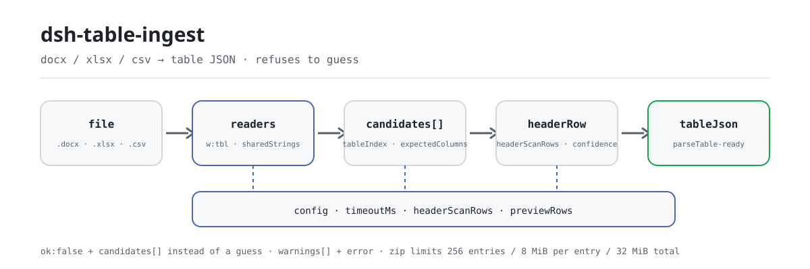

<div align="center">

<picture>
  <source media="(prefers-color-scheme: dark)" srcset="docs/assets/dsh-table-ingest-flow-dark.svg">
  
</picture>

# dsh-table-ingest

**docx, xlsx और csv को ऐसे तालिका JSON में बदलें जिसे नियम-जाँचकर्ता सीधे खपत कर सके — और यह भी बताएँ कि कौन-सी तालिका चुनी और क्या वह निश्चित है।**

DeepSeek Harness के लिए संरचना-परिवर्तक: एक ही Word में कई तालिकाएँ, मर्ज किए गए सेल, हेडर के ऊपर शीर्षक पंक्ति — सब कुछ कॉलम नाम, पंक्तियों और एक विश्वास स्तर में पढ़ा जाता है; और जब नहीं हो पाता, तो यह बताता है, अनुमान नहीं लगाता।

[इंस्टॉल](#तीन-चरणों-में-शुरुआत) · [कॉन्फ़िगरेशन](#कॉन्फ़िगरेशन) · [FAQ](#faq) · [简体中文](README.md) · [English](README.en.md) · [Español](README.es.md) · [Português](README.pt.md) · [हिन्दी](README.hi.md)

[](LICENSE)
[](#संगतता)
[](https://www.npmjs.com/package/dsh-table-ingest)
[](https://github.com/PerryLink/dsh-table-ingest/actions/workflows/ci.yml)
[](#संगतता)

[](https://github.com/PerryLink/dsh-table-ingest/stargazers)
[](https://www.npmjs.com/package/dsh-table-ingest)
[](https://dshfind.com/plugins/PerryLink/dsh-table-ingest?ref=badge)
[](https://securityscorecards.dev/viewer/?uri=github.com/PerryLink/dsh-table-ingest)

```sh
dsh plugin --profile <name> add dsh-table-ingest
```

</div>

<sub>सामुदायिक प्लगइन, DeepSeek से असंबद्ध। कैनोनिकल रिपॉज़िटरी: <https://github.com/PerryLink/dsh-table-ingest>।</sub>

## यह क्या है

`dsh-table-ingest` `.docx`, `.xlsx`, `.xlsm`, `.csv` और `.tsv` फ़ाइलों को उस तालिका JSON में बदलता है जिसे इस परिवार के नियम-जाँचकर्ता खपत करते हैं। जाँचकर्ता केवल उसी तालिका को पढ़ सकता है जिसे वह पहचानता है, और असली कार्यालयी दस्तावेज़ अक्सर कई तालिकाओं, मर्ज किए गए सेल और हेडर के ऊपर शीर्षक पंक्ति वाले Word फ़ाइल होते हैं। यह पैकेज वही एक कदम है — और उससे भी ज़रूरी, **जब बदलना संभव न हो तो यह बताता है, अनुमान नहीं लगाता**।

यह किसी व्यावसायिक निर्णय तक नहीं जाता: न तय करता है कि दस्तावेज़ अनुरूप है, न दायित्व ठहराता है, और इसके अपने कोई नियम नहीं हैं — `rules/table-ingest.yaml` जानबूझकर खाली है।

- **किसके लिए**: उन कर्मचारियों के लिए जिन्हें तालिका-सामग्री नियम-जाँच में डालनी होती है; कमांड लाइन की ज़रूरत नहीं, बातचीत में फ़ाइल सौंप दें।
- **आप क्या देते हैं**: एक `.docx` / `.xlsx` / `.xlsm` / `.csv` / `.tsv` फ़ाइल का स्थानीय पथ। मूल फ़ाइल कभी नहीं बदली जाती।
- **यह क्या देता है**: तालिका JSON, विश्वास स्तर के साथ कॉलम नाम और आकार, और आँख से पुष्टि के लिए एक पूर्वावलोकन तालिका; तालिका न मिलने पर उम्मीदवारों की सूची और कारण।

## तीन चरणों में शुरुआत

1. **इंस्टॉल करें** (कोई एक चैनल):

   ```sh
   # git चैनल (नवीनतम main; git+https://github.com/PerryLink/dsh-table-ingest.git के बराबर)
   dsh plugin --profile <name> add github:PerryLink/dsh-table-ingest
   # npm चैनल (प्रकाशित संस्करण)
   dsh plugin --profile <name> add dsh-table-ingest
   # tarball चैनल: इस रिपॉज़िटरी में pnpm pack के बाद
   dsh plugin --profile <name> add ./dsh-table-ingest-<version>.tgz
   ```

2. **न्यूनतम कॉन्फ़िग** (डिफ़ॉल्ट ही काफ़ी हैं; `config` के बिना bundle पंक्ति इन्हीं पर चलती है):

   ```yaml
   - insert:
       - id: dsh-table-ingest
         name: dsh-table-ingest
   ```

3. **सत्यापित करें कि सक्रिय है**:

   ```sh
   dsh --profile <name> --dump-config | grep 'dsh-table-ingest'
   ```

   फिर एक फ़ाइल सौंपें। साथ दिए नमूने से (पहले `pnpm run build` चलाएँ ताकि `lib/` बन जाए) चार पंक्तियों का सारांश छपता है, और उससे बनने वाला पूरा JSON [उदाहरण](#उदाहरण) में दिया है।

   ```sh
   $ node samples/quickstart/run.mjs
   table_ingest: docx, ok, 4 rows x 3 columns, confidence medium
   ```

   *Observed from `docs/assets/quickstart.log`; `samples/quickstart/expected/result.json`*

**अनइंस्टॉल**: `dsh plugin --profile <name> remove dsh-table-ingest` (या profile patch से वह पंक्ति हटा दें)।

## मुख्य क्षमताएँ

`dsh-table-ingest` टूल `table_ingest` पंजीकृत करता है: एक फ़ाइल पढ़ता है, एक तालिका चुनता है, आगे के जाँचकर्ता के लिए तालिका JSON लौटाता है, और हर निर्णय का आधार बताता है।

- **एक पाइपलाइन, पाँच फ़ॉर्मैट** — `.docx`, `.xlsx`, `.xlsm`, `.csv` और `.tsv` सब उन्हीं चरणों से गुज़रते हैं (तालिका चुनना → हेडर पहचानना → पूर्वावलोकन → तालिका JSON)। CSV/TSV में RFC 4180 उद्धरण और विभाजक की पहचान है, और जब बाइट्स वैध UTF-8 न हों तो GB18030 पर लौटते हैं — Windows पर Excel से निर्यात किए गए चीनी CSV की सामान्य एन्कोडिंग, जहाँ सीधा UTF-8 डिकोड हर कॉलम नाम को प्रतिस्थापन अक्षर बना देता है।
- **कई तालिकाएँ, अनुमान नहीं** — जब एक से अधिक तालिकाएँ समान रूप से संभव हों तो यह उम्मीदवारों को उनके आकार के साथ लौटाता है और `tableIndex` से चुनने को कहता है; `expectedColumns` सबसे मज़बूत संकेत है और अस्पष्ट दस्तावेज़ को निश्चित चुनाव में बदल देता है।
- **विश्वास स्तर के साथ हेडर पहचान** — पहली `headerScanRows` पंक्तियों (डिफ़ॉल्ट 6) पर बोल्ड, शेडिंग, `tblHeader`, छोटा पाठ, अंकों की अनुपस्थिति और छोटी शब्दावली के आधार पर अंक देता है, और परिणाम को `high` / `medium` / `low` बताता है; `low` का अर्थ है «किसी इंसान को देखना चाहिए»।
- **मर्ज किए गए सेल भरे जाते हैं, छोड़े नहीं** — `w:gridSpan` क्षैतिज रूप से फैलता है, `w:vMerge` (बिना `w:val`) ऊपर का सेल जारी रखता है, पृष्ठ बदलने पर जारी तालिका हेडर से मिलाई जाती है, और पूरी चौड़ाई की मर्ज पंक्ति समूह लेबल मानकर छोड़ दी जाती है; इनमें से हर कदम `warnings` में बताया जाता है।
- **गलत तालिका, तालिका न होने से महँगी** — पूर्वावलोकन «क्या यही वह तालिका है जो आप चाहते थे?» पर समाप्त होता है और कभी «रूपांतरण सफल» नहीं कहता; तालिका न मिलना, हेडर न पहचानना और पंक्ति के सेल न मिलना — सब `error` और `warnings` में आता है।
- **केवल-पठन, बिना नेटवर्क** — सिर्फ़ वही एक फ़ाइल पढ़ता है जो आप देते हैं, उसे कभी वापस नहीं लिखता, शुद्ध ESM है, और कोई नेटवर्क अनुरोध या मॉडल कॉल नहीं करता।
- **लाइब्रेरी प्रवेश** — `dsh-table-ingest/api` वही रूपांतरण सामान्य फ़ंक्शन के रूप में देता है (`ingestToTable`, `readWorkbook`, `readDelimited`, `serialToDate`, …), इसलिए दूसरे पैकेज को न टूल पंजीकरण चाहिए, न OOXML रीडर की दूसरी प्रति।

### यह क्या उत्तर देता है

- इस दस्तावेज़ में वास्तव में कौन-सी तालिकाएँ हैं, और हर एक कितनी बड़ी है?
- कौन-सी पंक्ति हेडर है, और कॉलम नाम क्या हैं?
- चुनी गई तालिका नियम चलाने लायक भरोसेमंद है, या पहले किसी इंसान से पुष्टि लेनी चाहिए?
- कोई उपयोगी तालिका नहीं है — क्योंकि दस्तावेज़ में है ही नहीं, या क्योंकि उसे OCR चाहिए?

### टूल सतह

`table_ingest` के सभी आर्ग्युमेंट वैकल्पिक हैं: खाली छोड़ने का अर्थ है «आप तय करें और बताएँ क्या तय किया», जो सामान्य स्थिति है; कोई मान देने पर वह अनुमान को केवल झुकाता नहीं, उसकी जगह लेता है।

| आर्ग्युमेंट | प्रकार | डिफ़ॉल्ट | अर्थ |
|---|---|---|---|
| `file` | string | अनिवार्य | निरपेक्ष पथ (`.docx` / `.xlsx` / `.xlsm` / `.csv` / `.tsv`) |
| `tableIndex` | number | खाली = स्वतः | कौन-सी तालिका लें (0 आधार); अस्पष्टता में उम्मीदवार लौटाता है, अनुमान नहीं लगाता |
| `headerRow` | number | खाली = लेआउट संकेत | कौन-सी पंक्ति हेडर है (1 आधार) |
| `expectedColumns` | string[] | `[]` | अपेक्षित कॉलम नाम; तालिका और हेडर चुनने का प्रमुख संकेत |
| `captionKeywords` | string[] | `[]` | तालिका शीर्षक में संभावित शब्द, जैसे «साइट लॉग» या «स्कोरिंग» |
| `previewRows` | number | कॉन्फ़िग का `previewRows` | पूर्वावलोकन कितनी डेटा पंक्तियाँ लौटाए |

### आउटपुट फ़ील्ड

| फ़ील्ड | अर्थ |
|---|---|
| `ok` | क्या पर्याप्त विश्वास के साथ एक ही तालिका पहचानी जा सकी |
| `tableIndex`, `headerRow`, `columns` | क्या चुना गया |
| `rowCount`, `candidateCount` | कितना पढ़ा गया और कितनी तालिकाएँ मिलीं |
| `confidence` | `high`, `medium` या `low` — `low` का अर्थ «किसी इंसान को देखना चाहिए» |
| `preview` | पुष्टि के लिए पहली पंक्तियों की markdown तालिका |
| `tableJson` | वह तालिका जिसका आकार नियम-जाँचकर्ता स्वीकार करता है |
| `warnings`, `error` | क्या अटपटा था, या कोई तालिका क्यों नहीं चुनी गई |

चुनी गई तालिका उसी आकार में निकलती है जिसे `parseTable` स्वीकार करता है, इसलिए जाँचकर्ता उसे सीधे खपत कर सकता है।

### उदाहरण

ये प्लगइन के वास्तविक प्रवेश-बिंदु हैं; एक बार इंस्टॉल करें, फिर कोई एक कॉल करें।

**विस्तृत उदाहरण** — टूल `table_ingest`, लक्ष्य `samples/quickstart/input/B-tender-multi-table.docx` (दो पृष्ठों में बँटी स्कोरिंग तालिका); `samples/quickstart/expected/result.json` का पूरा पाठ:

```json
{
  "tool": "table_ingest",
  "format": "docx",
  "ok": true,
  "confidence": "medium",
  "tableIndex": 0,
  "headerRow": 1,
  "columns": [
    "评审因素",
    "分值",
    "评分标准"
  ],
  "rowCount": 4,
  "candidateCount": 1,
  "warnings": [
    "与第 2 张表表头相同，已按跨页续表合并",
    "第 3 行是整行合并的分组行「服务部分」，已跳过（未作为数据行）",
    "第 2 张表与上一张表表头相同，已合并为一张"
  ]
}
```

तीनों `warnings` बताते हैं कि इसने क्या किया: पृष्ठ-पार जारी तालिका हेडर से मिलाई गई, पूरी चौड़ाई की मर्ज समूह-पंक्ति लेबल मानकर छोड़ी गई, और एक ही हेडर वाली दो तालिकाएँ एक हो गईं — इनमें से कुछ भी चुपचाप नहीं होता।

*Observed from `samples/quickstart/expected/result.json`; `src/ingest/table-json.ts`*

**विफलता शाखा** — टूल `table_ingest` `C-hedui-baogao.docx` पढ़ते हुए (कई तालिकाएँ समान रूप से संभव): परिणाम `ok: false` है, `error` में `tableIndex` का नाम आता है, `candidates` हर उम्मीदवार की पंक्ति-स्तंभ संख्या, हेडर पंक्ति और शीर्षक बताता है, और markdown यह कहकर समाप्त होता है कि `tableIndex` से इनमें से एक चुनें और फिर प्रयास करें। अपेक्षित कॉलम नामों के साथ `expectedColumns` देने पर वही दस्तावेज़ निश्चित रूप से हल हो जाता है।

*Observed from `tests/index.test.ts:63-79`; `src/view.ts:84-100`*

**संक्षिप्त उदाहरण**: `node samples/quickstart/run.mjs --json` · `node samples/quickstart/run.mjs --check`

## यह किस मानक को सन्निहित करता है

यह पैकेज कोई कानूनी या नियामक धारा सन्निहित नहीं करता, इसलिए इसका नियम-पैक खाली है और उद्धृत करने के लिए कोई साक्ष्य निर्देशिका नहीं है। जो यह सन्निहित करता है वह `word/document.xml` और `xl/worksheets/*.xml` की OOXML संरचना है:

- तालिका संरचना के लिए `<w:tbl>`, `<w:tr>`, `<w:tc>`; क्षैतिज विलय के लिए `<w:gridSpan>` और «ऊपर का सेल जारी रखें» के लिए `<w:vMerge/>` (बिना `w:val`) — यह XML में *खाली* होता है, इसलिए इसे नीचे भरना ज़रूरी है, वरना पूरा दस्तावेज़ तारीखें गुम होने जैसा दिखता है।
- हेडर संकेत के रूप में `<w:tblHeader>` के साथ शेडिंग और बोल्ड; फ़ॉर्मैट में «हेडर पंक्ति» की कोई मानक परिभाषा नहीं है, इसलिए हेडर पहचान अंक-आधारित अनुमान है और परिणाम विश्वास स्तर के साथ बताया जाता है।
- साझा स्ट्रिंग के लिए `sharedStrings.xml` (`<v>` में *सूचकांक* है, मान नहीं), इनलाइन स्ट्रिंग (`t="inlineStr"`, जिसका मान `<v>` में नहीं है), और तीन-स्तरीय अप्रत्यक्षता `c@style` → `cellXfs` → `numFmtId` जो तय करती है कि कोई संख्या तारीख है या नहीं।

### नियम-पैक खाली है

यह पैकेज कोई धारा उद्धृत नहीं करता, इसलिए इसकी `rules/evidence/` निर्देशिका नहीं है और नियम-पैक डिज़ाइन से खाली है। इसे इससे पुष्ट करें:

```sh
pnpm run check:citations   # अपेक्षा: 0 segments, 0 placeholders, 0 untraceable
```

`rules/table-ingest.yaml` को हटाने के बजाय रखने का कारण फ़ाइल के शीर्ष पर लिखा है: परिवार की पैकेज-संरचना हर पैकेज को एक `rules/<pack>.yaml` देती है जिसे औज़ार खोजते हैं, और नियमों को डेटा से अलग रखना ही आगे के नियम-पैक को इस पैकेज का आउटपुट खपत करने देता है। भविष्य में यहाँ «सामग्री संरचना» का नियम जोड़ना हो (जैसे «इस तालिका में हेडर होना चाहिए») तो उसी फ़ाइल में बाक़ी नियम-पैक जैसे प्रारूप में जोड़ें।

## सामग्री प्रारूप

शीर्षक पंक्ति, हेडर पंक्ति और दो डेटा पंक्तियों वाला एक `.docx`:

```
序号 | 日期        | 施工部位   | 监理情况
1    | 2026-10-08  | 1#楼三层   | 旁站检查…
2    | 2026-10-08  | 1#楼三层   | 旁站全过程…
```

बन जाता है:

```json
{
  "target": "site-log.docx",
  "tableIndex": 0,
  "headerRows": [2],
  "columns": ["序号", "日期", "施工部位", "监理情况"],
  "header": {},
  "rows": [
    { "序号": "1", "日期": "2026-10-08", "施工部位": "1#楼三层", "监理情况": "旁站检查…" },
    { "序号": "2", "日期": "2026-10-08", "施工部位": "1#楼三层", "监理情况": "旁站全过程…" }
  ],
  "warnings": ["1 个单元格为空，已从上方合并单元格补值"],
  "mergedCells": 1,
  "sections": [],
  "ragged": false
}
```

`.csv` और `.tsv` वही आकार देते हैं, `headerRows` `[1]` होता है। सभी मान स्ट्रिंग रहते हैं, इसलिए अग्रणी शून्य बचा रहता है।

## कॉन्फ़िगरेशन

हर समायोज्य विकल्प `src/config.ts` में Schemastery `Config` फ़ील्ड है (cordis.yml से बदला जा सकता है)। id से बदलने पर पूरी पंक्ति बदल जाती है — ज़रूरी सभी कुंजियाँ दोबारा लिखें। यह पैकेज रूपांतरक है, नियम-जाँचकर्ता नहीं, इसलिए नियम चालू-बंद करने की कुंजियाँ नहीं हैं, केवल अनुमानों की सीमाएँ और टूल का समय-बजट:

| कुंजी | प्रकार | डिफ़ॉल्ट | अर्थ |
|---|---|---|---|
| `timeoutMs` | number | `60000` | टूल का समय-बजट (मिलीसेकंड) |
| `headerScanRows` | number | `6` | हेडर तय करने के लिए कितनी पंक्तियाँ नीचे देखी जाएँ; इससे नीचे का हेडर «हेडर नहीं» बताया जाता है |
| `previewRows` | number | `10` | पुष्टि-पूर्वावलोकन डिफ़ॉल्ट रूप से कितनी डेटा पंक्तियाँ लौटाए |

profile patch में बदलाव का उदाहरण:

```yaml
- insert:
    - id: dsh-table-ingest
      name: dsh-table-ingest
      config:
        headerScanRows: 10
        previewRows: 20
        timeoutMs: 180000
```

## FAQ

<details>
<summary>क्या मेरी फ़ाइल अपलोड होती है? क्या यह नेटवर्क पर जाता है?</summary>

नहीं। यह केवल वही एक स्थानीय फ़ाइल पढ़ता है जो आप देते हैं, कोई नेटवर्क अनुरोध नहीं करता, किसी मॉडल को नहीं बुलाता, मूल फ़ाइल को कभी वापस नहीं लिखता और दूसरी प्रति नहीं रखता (`package.json#dsh.demo` में `network: false`, `writes: []`, और एक ही पठन: निकाली जाने वाली .docx फ़ाइल)। परिणाम केवल उसी टूल कॉल के रिटर्न मान में रहता है।

</details>

<details>
<summary>कई तालिकाएँ हों तो क्या यह चुपचाप एक चुन लेगा?</summary>

नहीं। जब दो या अधिक तालिकाएँ एक ही संकेतों पर नज़दीकी अंक लेती हैं, तो यह उम्मीदवारों को पंक्ति-स्तंभ संख्या और हेडर की स्थिति के साथ सूचीबद्ध करता है, `ok` को `false` करता है, और `tableIndex` से एक चुनने को कहता है; `expectedColumns` प्रायः एक ही बार में हल कर देता है और सबसे प्रभावी आर्ग्युमेंट है। जो तालिका वास्तव में चुनी जाती है उसके साथ पूर्वावलोकन आता है जो «क्या यही वह तालिका है जो आप चाहते थे?» पर समाप्त होता है, क्योंकि यह कभी रूपांतरण सफल होने का दावा नहीं करता।

</details>

<details>
<summary>मेरी तालिका में हेडर के ऊपर शीर्षक पंक्ति है, या हेडर बहुत नीचे है। तब क्या?</summary>

हेडर पहचान केवल पहली `headerScanRows` पंक्तियाँ देखती है (डिफ़ॉल्ट 6); उससे नीचे का हेडर «हेडर नहीं» बताया जाता है, अनिश्चित रूप से खोजा नहीं जाता। यह जानबूझकर है: मुख्य पाठ को हेडर मानने पर आगे का हर नियम गलत बजता है। ऐसे दस्तावेज़ों के लिए `headerRow` (1 आधार) से पंक्ति बता दें। दो-स्तरीय हेडर भी जानबूझकर नहीं मिलाए जाते — कारण «ज्ञात सीमाएँ» में है।

</details>

<details>
<summary>किसी ने भेजी दुर्भावनापूर्ण docx मेमोरी उड़ा सकती है?</summary>

0.2.1 से कठोर सीमाएँ हैं: डिकंप्रेशन से पहले वह पैकेज अस्वीकार होता है जो 256 से अधिक एंट्री, 4 KiB से लंबा एंट्री नाम, या 8 MiB से बड़ी संपीड़ित एंट्री घोषित करता है; deflate आउटपुट प्रति एंट्री 8 MiB और कुल 32 MiB तक सीमित है (`inflateRawSync({ maxOutputLength })`), इसलिए वैध पर दुर्भावनापूर्ण deflate स्ट्रीम असीमित नहीं फैल सकती। ये सुरक्षा-सीमाएँ हैं, समायोज्य विकल्प नहीं।

</details>

<details>
<summary>क्या इसके अपने नियम हैं? क्या यह अनुरूपता तय कर सकता है?</summary>

नहीं, और नहीं। `rules/table-ingest.yaml` में `rules` खाली सरणी है — यह पैकेज केवल संरचना बदलता है, कोई अंतर, अंक या दायित्व नहीं निकालता। अनुरूपता तय करने के लिए इसका `tableJson` असली नियम-पैक (परिवार के 62 जाँचकर्ता) को दें।

</details>

## समस्या निवारण

- **प्लगइन इंस्टॉल हुआ पर टूल दिखता नहीं।** जाँचें कि `main` `lib/index.mjs` पर हल होता है और `pnpm run build` ने उसे बनाया है; गलत `main` पर लोडर उस पंक्ति को चुपचाप छोड़ देता है।
- **`dsh plugin add` असंगत कहकर मना करता है।** यहाँ `engines.dsh` `>=0.2.1-0 <0.3.0` है, और peer सीमा `0.1.x` तथा `0.2.x` दोनों को समेटती है; उसके बाहर हों तो स्पष्ट छूट दें।
- **तालिका बिना हेडर लौटी, या स्पष्ट रूप से गलत हेडर चुना।** `headerRow` (1 आधार) से बता दें या `headerScanRows` बढ़ाएँ; `confidence: low` ठीक वही «किसी इंसान को देखना चाहिए» संकेत है।
- **आगे का कोई नियम नहीं चला।** उस रिपोर्ट की `skipped` सरणी पढ़ें — यह पैकेज केवल तालिका देता है, नियम आगे के पैक में चलते हैं; गलत पढ़ी तालिका के कारण आगे की रिपोर्ट ऐसे अंतर बताती है जो हैं ही नहीं, इसलिए पहले `ok` और पूर्वावलोकन देखें।
- **चार तालिकाओं वाला दस्तावेज़ हर बार पूछता ही है।** `expectedColumns` दें; अस्पष्टता निश्चित चुनाव बन जाती है।

## सुरक्षा सीमाएँ

- **ZIP सीमाएँ** (0.2.1 से)। DOCX/XLSX इनपुट अविश्वसनीय है: डिकंप्रेशन से पहले पैकेज अस्वीकार होता है यदि वह 256 से अधिक एंट्री, 4 KiB से लंबा एंट्री नाम, या 8 MiB से बड़ी संपीड़ित एंट्री घोषित करता है; deflate आउटपुट प्रति एंट्री 8 MiB और कुल 32 MiB तक सीमित है।
- **निर्देशिका सीमाएँ।** नाम, extra, टिप्पणी और लोकल-हेडर की लंबाई पढ़ने से पहले बफ़र के विरुद्ध जाँची जाती है; कटी हुई निर्देशिका या पैकेज से बाहर का लोकल ऑफ़सेट आंशिक डेटा लौटाने के बजाय `ZipError` देता है।
- **केवल-पठन।** जो फ़ाइल पढ़ी उसे कभी वापस नहीं लिखता और प्रति नहीं बनाता; कॉल के बीच कोई स्थिति साझा नहीं होती (`isConcurrencySafe: () => true`)।
- **विफलता दिखती है।** जब कोई तालिका न पहचानी जाए तो परिणाम `ok: false` + `error` + उम्मीदवार सूची होता है, कभी गढ़ी हुई एक-कॉलम तालिका नहीं: «एक कॉलम पाठ» को आगे का कोई कॉलम उपनाम स्वीकार नहीं करता, इसलिए «तालिका नहीं मिली» बताना ही ईमानदार उत्तर है।
- **कोई व्यावसायिक निर्णय नहीं।** न नियम, न अंक, न अनुरूपता का फ़ैसला; `rules/table-ingest.yaml` खाली पैक है और `check:citations` की अपेक्षा 0 segments / 0 placeholders / 0 untraceable है।
- **बिना नेटवर्क, बिना मॉडल कॉल, बिना नेटिव कोड।** शुद्ध ESM, पूरी तरह स्थानीय स्ट्रिंग और बाइट प्रोसेसिंग।

## अनुमतियाँ और डेटा

- **अनुमतियाँ**: manifest केवल `tools:register` घोषित करता है; `package.json#dsh.demo` में एक पठन (निकाली जाने वाली .docx फ़ाइल), कोई लेखन नहीं, और `network: false` है।
- **डेटा**: कुछ भी डिस्क पर नहीं लिखा जाता, अपलोड नहीं होता, दोहराया नहीं जाता; रूपांतरण केवल उसी कॉल के रिटर्न मान में रहता है।
- **सत्र लॉग**: परिणाम का पाठ होस्ट सत्र में दर्ज करता है (होस्ट का व्यवहार); यह प्लगइन अपना कोई सत्र इवेंट प्रकार न घोषित करता है न जोड़ता है।
- **गोपनीयता**: [`PRIVACY.md`](PRIVACY.md) स्वयं npm पैकेज को कवर करता है, DSH होस्ट या profile के अन्य प्लगइनों को नहीं।

## ज्ञात सीमाएँ

- **हेडर पहचान अनुमान-आधारित है।** यह पहली छह पंक्तियों पर बोल्ड, शेडिंग, `tblHeader`, छोटा पाठ, अंकों की अनुपस्थिति और छोटी शब्दावली के आधार पर अंक देती है। इससे नीचे का हेडर «हेडर नहीं» बताया जाता है, अनिश्चित रूप से खोजा नहीं जाता।
- **दो-स्तरीय हेडर डिफ़ॉल्ट रूप से नहीं मिलाए जाते।** मिलाने से आगे का उपनाम-मिलान टूटता है (`amount (yuan)/total` शीर्षक वाला कॉलम उपनाम `total` नहीं है), इसलिए सबसे विशिष्ट पंक्ति ली जाती है, और मूल लेबल केवल तब जोड़ा जाता है जब संतति-नाम दोहराया जाए।
- **असमान तालिका बताई जाती है, ठीक नहीं की जाती।** जब किसी पंक्ति के सेल घोषित चौड़ाई के बराबर न हों, परिणाम `ragged` और विश्वास `low` होता है; फ़ाइल में लेखक का आशय पुनः प्राप्त करने की जानकारी नहीं है।
- **`expectedColumns` आपका सबसे मज़बूत संकेत है।** इसे देने पर चार तालिकाओं वाला अस्पष्ट दस्तावेज़ निश्चित चुनाव बन जाता है।
- **`.doc` (BIFF), स्कैन की गई छवियाँ और PDF नहीं पढ़े जाते।** उनके लिए कनवर्टर या OCR चाहिए जो यह परिवार जानबूझकर साथ नहीं रखता; बाइनरी `.doc` और `.xls` प्रारूप भी समर्थित सतह से बाहर हैं।
- **नियम-पैक खाली है।** यह पैकेज कोई धारा उद्धृत नहीं करता और इसकी `rules/evidence/` निर्देशिका नहीं है — अनुरूपता का फ़ैसला इसका काम नहीं है।

## अन्य DSH प्लगइनों के साथ इंटरऑपरेबिलिटी

- **एक ही टूल, एक बार पंजीकृत।** टूल id `table_ingest` है, `inject: ['tools']` के साथ — `tools` सेवा न हो तो प्लगइन लोड ही नहीं होता, इसलिए यह कभी आधा-अधूरा शुरू नहीं होता।
- **न सेवा-कुंजी, न slot, न HTTP मार्ग।** यह कोई सेवा-कुंजी नहीं देता, कोई क्लाइंट slot कुंजी पंजीकृत नहीं करता, कोई `webServer` प्रीफ़िक्स पंजीकृत नहीं करता, और न प्रोटोटाइप बदलता है, न `process.env` फिर लिखता है, न वैश्विक fetch डिस्पैचर बदलता है।
- **bundle patch केवल अपनी पंक्ति `insert` करता है।** `cordis.patch.yml` कभी किसी अंतर्निहित पंक्ति का `config` नहीं लिखता, इसलिए किसी अन्य patching प्लगइन से टकराव नहीं होता।
- **पंजीकरण एक effect है।** `ctx.tools.register` disposer लौटाता है, इसलिए हॉट रीलोड और अनलोड से टूल हट जाता है।
- **आउटपुट उपभोक्ता से मेल खाता है।** तालिका JSON का आकार वही है जो `parseTable` स्वीकार करता है, और एक टेस्ट «produces table JSON the engine can consume» कहता है, इसलिए परिवार के नियम-पैक इसे बिना अडैप्टर सीधे खपत करते हैं।

## संगतता

| सतह | स्थिति |
|---|---|
| Harness | `engines.dsh` `>=0.2.1-0 <0.3.0` है; peer सीमा `>=0.1.2-rc.1 <0.2.0 \|\| >=0.2.0-0 <0.3.0` (0.1.x और 0.2.x दोनों पंक्तियाँ समाहित) |
| Node | `^22.19.0 \|\| >=24.0.0` |
| प्लेटफ़ॉर्म | सभी (शुद्ध ESM; नेटिव कोड नहीं, नेटवर्क नहीं, मॉडल कॉल नहीं) |
| इनपुट प्रारूप | `.docx`, `.xlsx`, `.xlsm`, `.csv`, `.tsv`; `.doc` (BIFF) नहीं, स्कैन नहीं, PDF नहीं |

## इकोसिस्टम और गुणवत्ता

- [npm पैकेज पृष्ठ](https://www.npmjs.com/package/dsh-table-ingest) (संस्करण, डाउनलोड, निर्भरताएँ)
- [dshfind प्लगइन पृष्ठ](https://dshfind.com/plugins/PerryLink/dsh-table-ingest) (इंस्टॉल और रैंकिंग)
- [OpenSSF Scorecard रिपोर्ट](https://securityscorecards.dev/viewer/?uri=github.com/PerryLink/dsh-table-ingest) ([.github/workflows/scorecard.yml](.github/workflows/scorecard.yml) से संचालित)
- [सामग्री के अनुसार जाँचकर्ता चुनें](https://perrylink.github.io/zh/checkers/choose/) (62 जाँचकर्ताओं की पूरी सूची; यह पैकेज उनकी ऊपरी परत है)
- [इकोसिस्टम ज्ञानकोश](https://perrylink.github.io/dsh-plugin-guide/): प्लगइन विकास मार्गदर्शिका · चयन डेटा · रखरखाव के मानदंड
- [PerryLink के सभी प्लगइन](https://github.com/PerryLink) (परिवार अवलोकन)

## डेवलपमेंट

```sh
pnpm install                                       # node ^22.19 || >=24
pnpm run typecheck                                 # tsc --noEmit
pnpm test                                          # vitest run: कॉन्ट्रैक्ट + सीमा-अर्थशास्त्र + ZIP सीमाएँ
pnpm run build                                     # tsdown -> lib/index.mjs + lib/index.d.mts
pnpm run verify:self-contained                     # निर्भरताएँ registry से हल होती हैं
pnpm run check:lockfile                            # lockfile ड्रिफ़्ट जाँच
pnpm run check:readmes                             # पाँच-भाषा README एकरूपता
pnpm run check:citations                           # नियम-पैक उद्धरण आधाररेखा
node ../scripts/sync-shared.mjs dsh-table-ingest   # ../_shared से src/shared ताज़ा करें
pnpm pack                                          # प्रकाशित tarball
```

स्वीकृति रिकॉर्ड [`ACCEPTANCE.csv`](ACCEPTANCE.csv) में है (`npx vitest run`, 25/25 उत्तीर्ण, स्रोत public/synthetic)। नमूना चलाने के लिए पहले `pnpm run build` आवश्यक है:

```sh
node samples/quickstart/run.mjs           # मनुष्य के लिए सारांश
node samples/quickstart/run.mjs --json    # वही सारांश JSON में
node samples/quickstart/run.mjs --check   # expected/result.json से तुलना
```

नमूना इनपुट `samples/quickstart/input/` में और संदर्भ आउटपुट `samples/quickstart/expected/result.json` में है; वास्तविक रन का स्क्रीनशॉट और टर्मिनल पाठ `docs/assets/quickstart.png` तथा `docs/assets/quickstart.log` हैं।

निर्देशिका संरचना:

| पथ | सामग्री |
|---|---|
| `src/index.ts` | प्लगइन प्रवेश: `name` / `inject` / `Config` / `apply`, `table_ingest` पंजीकृत करता है |
| `src/config.ts` | Schemastery स्कीमा (हर समायोज्य विकल्प यहीं) |
| `src/ingest/` | प्रारूप रीडर: `docx.ts`, `xlsx.ts`, `csv.ts`, `zip.ts`, `xml.ts`, और चयन/हेडर पाइपलाइन `ingest.ts`, `table-json.ts` |
| `src/view.ts` | मॉडल की ओर प्रक्षेपण: `markdown` सारांश, पूर्वावलोकन और उम्मीदवारों की शब्दावली |
| `src/api.ts` | लाइब्रेरी प्रवेश `dsh-table-ingest/api` |
| `src/shared/` | साथ रखा साझा किट (तालिका, ruleset, YAML उपसमुच्चय, तिथि गणना, शब्दावली गार्ड) |
| `rules/table-ingest.yaml` | खाली नियम-पैक (संरचना परंपरा, देखें «नियम-पैक खाली है») |
| `tests/` | vitest: कॉन्ट्रैक्ट, सीमा-अर्थशास्त्र, ZIP सीमाएँ; `fixtures/` में वास्तविक संश्लेषित docx/xlsx/csv |
| `samples/quickstart/` | दोबारा चलाने योग्य नमूना और उसका संदर्भ आउटपुट |
| `docs/assets/` | चित्र और वास्तविक टर्मिनल आउटपुट |

README के चित्र [`scripts/gen-readme-assets.py`](scripts/gen-readme-assets.py) से क्रमादेशित रूप से बनते हैं (शुद्ध SVG, कमांड-टोकन पाठ, हल्का और गहरा दोनों संस्करण) और दोबारा चलाए जा सकते हैं: `python scripts/gen-readme-assets.py`। पुराना एक-संस्करण आरेख और डेमो बाहरी लिंक के लिए `docs/assets/` में बने रहते हैं; README केवल नए जोड़े का संदर्भ देते हैं।

Topics: `deepseek-harness`, `dsh`, `dsh-plugin`, `cordis`, `ingest`, `docx`, `xlsx`, `csv`, `table`

## परिवार और आभार

यह परियोजना [PerryLink](https://github.com/PerryLink) द्वारा अनुरक्षित DeepSeek Harness प्लगइन परिवार का हिस्सा है (सभी Apache-2.0)। पूरा परिवार सूचकांक [सामग्री के अनुसार जाँचकर्ता चुनें](https://perrylink.github.io/zh/checkers/choose/) पर है; यह पैकेज उन 62 जाँचकर्ताओं की ऊपरी रूपांतरण परत है। अगर यह उपयोगी लगे, तो **एक स्टार अगले व्यक्ति को इसे खोजने में मदद करता है** — इसके पीछे कोई सुविधा बंद नहीं है।

- [@PerryLink](https://github.com/PerryLink) — निर्माता और अनुरक्षक: OOXML और विभाजित-पाठ रीडर, तालिका-चयन और हेडर अनुमान, `table_ingest` टूल, `dsh-table-ingest/api` लाइब्रेरी प्रवेश, और पाँच-भाषा दस्तावेज़।

## लाइसेंस

[LICENSE](LICENSE) (Apache License 2.0) © 2026 dsh-table-ingest contributors

<p align="center"><sub>Apache-2.0 · सामुदायिक प्लगइन, DeepSeek से असंबद्ध।</sub></p>
