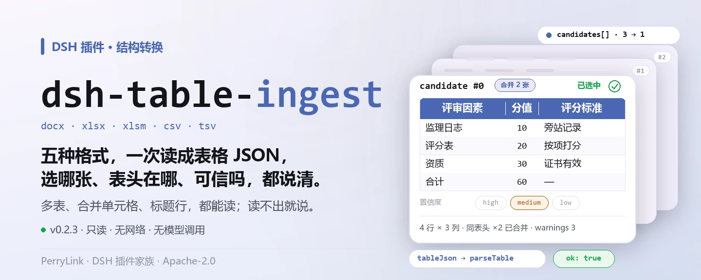
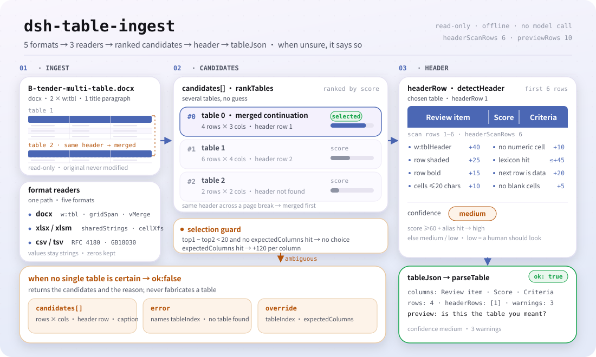

<div align="center">

<picture>
  <source media="(prefers-color-scheme: dark)" srcset="docs/assets/dsh-table-ingest-hero-zh-dark.webp">
  
</picture>

# dsh-table-ingest

**把 docx、xlsx、csv 转成规则检查器能直接吃的表格 JSON——并且说清它抽的是哪张表、对不对。**

面向 DeepSeek Harness 的结构转换插件：Word 里的多张表、合并单元格、表头之上的标题行，它一次读成列名、行与置信度；抽不出来时它明说，不猜。

[安装](#三步上手) · [配置](#配置) · [FAQ](#faq) · [简体中文](README.md) · [English](README.en.md)

[](LICENSE)
[](#兼容性)
[](https://www.npmjs.com/package/dsh-table-ingest)
[](https://github.com/PerryLink/dsh-table-ingest/actions/workflows/ci.yml)
[](#兼容性)

[](https://github.com/PerryLink/dsh-table-ingest/stargazers)
[](https://www.npmjs.com/package/dsh-table-ingest)
[](https://dshfind.com/plugins/PerryLink/dsh-table-ingest?ref=badge)
[](https://securityscorecards.dev/viewer/?uri=github.com/PerryLink/dsh-table-ingest)

```sh
dsh plugin --profile <name> add dsh-table-ingest
```

</div>

<sub>社区插件，与 DeepSeek 官方无关。唯一仓库：<https://github.com/PerryLink/dsh-table-ingest>。</sub>

## 它是什么

`dsh-table-ingest` 把 `.docx`、`.xlsx`、`.xlsm`、`.csv`、`.tsv` 文件转成本族规则检查器能吃的表格 JSON。检查器只能读它认得出的表；而职场里的真实文档多是带多张表、合并单元格、表头之上还有标题行的 Word。这个包就是那一步转换——更重要的是，**转不出来时它会说，而不是猜**。

它不做任何业务判断：不判定材料是否合规，不认定责任，也没有自己的规则——`rules/table-ingest.yaml` 是刻意留空的。

- **给谁用**：要把表格材料送进规则核对的经办人；不用懂命令行，在对话里把文件交给它即可。
- **你交什么**：一份 `.docx` / `.xlsx` / `.xlsm` / `.csv` / `.tsv` 文件的本机路径；原件永不修改。
- **它交什么**：表格 JSON、带置信度的列名与规模、一张给人眼确认的预览表；抽不出表时给出候选清单与原因。

<picture>
  <source media="(prefers-color-scheme: dark)" srcset="docs/assets/dsh-table-ingest-flow-v5-dark.svg">
  
</picture>

## 三步上手

1. **安装**（三选一）：

   ```sh
   # git 通道（最新 main；等价于 git+https://github.com/PerryLink/dsh-table-ingest.git）
   dsh plugin --profile <name> add github:PerryLink/dsh-table-ingest
   # npm 通道（已发布版本）
   dsh plugin --profile <name> add dsh-table-ingest
   # tarball 通道：本仓库 pnpm pack 后
   dsh plugin --profile <name> add ./dsh-table-ingest-<version>.tgz
   ```

2. **最小配置**（默认即可用；bundle 行不带 `config` 时全部走默认值）：

   ```yaml
   - insert:
       - id: dsh-table-ingest
         name: dsh-table-ingest
   ```

3. **验证已生效**：

   ```sh
   dsh --profile <name> --dump-config | grep 'dsh-table-ingest'
   ```

   再把一份文件交给它。用仓内自带样例（先 `pnpm run build` 产出 `lib/`）：

   ```sh
   $ node samples/quickstart/run.mjs
   table_ingest: docx, ok, 4 rows x 3 columns, confidence medium
   columns: 评审因素 | 分值 | 评分标准
   candidates: 1, header row: 1, warnings: 3
   ```

   *Observed from `docs/assets/quickstart.log`；`samples/quickstart/expected/result.json`*

**卸载**：`dsh plugin --profile <name> remove dsh-table-ingest`（或从 profile patch 删掉该行）。

## 核心能力

`dsh-table-ingest` 注册 `table_ingest` 工具：读一个文件，选一张表，交出下游检查器能直接消费的表格 JSON，并附上它做这些判断的依据。

- **一次读五种格式** —— `.docx`、`.xlsx`、`.xlsm`、`.csv`、`.tsv` 走同一条管线（选表 → 认表头 → 预览 → 表格 JSON）。CSV/TSV 支持 RFC 4180 引号与分隔符嗅探，并在字节不是合法 UTF-8 时回退 GB18030——Windows 上 Excel 导出的中文 CSV 常见这种编码，按 UTF-8 硬解会把每个列名变成替换字符。
- **多表不猜** —— 一份文档里有几张表都可能说得通时，它返回候选与各自规模，要求你用 `tableIndex` 指定；`expectedColumns` 是最强的一个信号，能把歧义文档变成确定性选择。
- **表头识别带置信度** —— 在前 `headerScanRows`（默认 6）行里按加粗、底纹、`tblHeader`、短文本、无数字、小词表打分，结果标 `high` / `medium` / `low`；`low` 的意思是「该有人看一眼」。
- **合并单元格补值** —— `w:gridSpan` 横向展开、`w:vMerge`（不带 `w:val`）沿用上一格向下补值；跨页续表按表头合并，整行合并的分组行按组标签跳过，每一步都在 `warnings` 里说明，不静默吞掉。
- **抽错比抽不出更贵** —— 预览表的结语是「请确认『抽到的是不是这张表』」，从不说「转换成功」；抽不到表、表头判不出、行列对不齐（`ragged`）都如实写进 `error` 与 `warnings`。
- **只读、不联网** —— 只读你给的那一个文件，永不改写原件；纯 ESM，无原生代码、无网络请求、不调用模型。
- **库入口** —— `dsh-table-ingest/api` 把同一套转换暴露成普通函数（`ingestToTable`、`readWorkbook`、`readDelimited`、`serialToDate` 等），别的包不必依赖工具注册，也不用再抄一份 OOXML 读取器。

### 它回答什么

- 这份文档里到底有几张表，各有多大？
- 哪一行是表头，列名是什么？
- 选定的这张表够不够可靠到可以跑规则，还是该先让人确认？
- 没有可用的表，是文档本来就没有，还是需要 OCR？

### 工具面

`table_ingest` 的全部参数都是可选的：留空即「自己判定，并告诉我判定了什么」，这是最常见的用法；填了就是覆盖启发式，而不只是给它一点偏好。

| 参数 | 类型 | 默认 | 含义 |
|---|---|---|---|
| `file` | string | 必填 | 文件绝对路径（`.docx` / `.xlsx` / `.xlsm` / `.csv` / `.tsv`） |
| `tableIndex` | number | 留空 = 自动判定 | 指定第几张表（0 基）；多表歧义时工具返回候选而不猜 |
| `headerRow` | number | 留空 = 按排版信号判定 | 指定表头行（1 基） |
| `expectedColumns` | string[] | `[]` | 期望列名；传入后选表与表头判定以它为主信号 |
| `captionKeywords` | string[] | `[]` | 表标题可能包含的关键词，如「监理日志」「评分」 |
| `previewRows` | number | 取配置 `previewRows` | 预览表返回多少行数据 |

### 输出字段

| 字段 | 含义 |
|---|---|
| `ok` | 是否以足够置信度定位到唯一一张表 |
| `tableIndex`、`headerRow`、`columns` | 选了什么 |
| `rowCount`、`candidateCount` | 读了多少行、发现几张表 |
| `confidence` | `high` / `medium` / `low`；`low` 表示「该有人看一眼」 |
| `preview` | 前几行的 markdown 表，供确认 |
| `tableJson` | 规则检查器可接受的表格形状 |
| `warnings`、`error` | 哪里奇怪，或为什么没选表 |

选定的表按 `parseTable` 接受的形状输出，检查器可直接消费。

### 示例

以下为插件真实入口；安装后调用一次即可。

**详细示例** — 工具 `table_ingest`，目标是 `samples/quickstart/input/B-tender-multi-table.docx`（一份跨两页的评分表），`samples/quickstart/expected/result.json` 的全文：

```json
{
  "tool": "table_ingest",
  "format": "docx",
  "ok": true,
  "confidence": "medium",
  "tableIndex": 0,
  "headerRow": 1,
  "columns": [
    "评审因素",
    "分值",
    "评分标准"
  ],
  "rowCount": 4,
  "candidateCount": 1,
  "warnings": [
    "与第 2 张表表头相同，已按跨页续表合并",
    "第 3 行是整行合并的分组行「服务部分」，已跳过（未作为数据行）",
    "第 2 张表与上一张表表头相同，已合并为一张"
  ]
}
```

三条 `warnings` 逐条说明它自己做了什么：跨页续表按表头合并、整行合并的分组行按组标签跳过、两张同表头的表合并成一张——都不静默。

*Observed from `samples/quickstart/expected/result.json`；`src/ingest/table-json.ts`*

**失败分支** — 工具 `table_ingest` 读 `C-hedui-baogao.docx`（多张表同样说得通）：结果是 `ok: false`，`error` 里点名 `tableIndex`，`candidates` 列出每张候选的行列数、表头行与标题，markdown 结语是「用 tableIndex 指定其中一张后重试。」；补一个 `expectedColumns: ['文件', '条目', '读取方式']` 后，同一份文档即可确定性命中。

*Observed from `tests/index.test.ts:63-79`；`src/view.ts:84-100`*

**简短示例**：`node samples/quickstart/run.mjs --json` · `node samples/quickstart/run.mjs --check`

## 它依据的标准

本包不编码任何法律或监管条款，所以规则库为空、也没有可引用的证据目录。它编码的是 `word/document.xml` 与 `xl/worksheets/*.xml` 的结构：

- `<w:tbl>`、`<w:tr>`、`<w:tc>` 描述表结构；`<w:gridSpan>` 是横向合并，`<w:vMerge/>`（不带 `w:val`）表示「沿用上一格」——后者在 XML 里是**空的**，不补下来，一份完整的文档会看起来缺日期。
- `<w:tblHeader>` 加底纹与加粗作为表头线索；格式本身没有「表头行」的规范定义，所以表头识别是打分启发式，结果带置信度。
- `sharedStrings.xml` 的共享串（`<v>` 里是**索引不是值**）、内联串（`t="inlineStr"`，值不在 `<v>` 里），以及 `c@style` → `cellXfs` → `numFmtId` 的三层间接——它决定一个数字是不是日期。

### 规则库为空

本包不引用条款，因此没有 `rules/evidence/` 目录，规则库按设计为空。可用下面这条确认：

```sh
pnpm run check:citations   # 期望 0 segments, 0 placeholders, 0 untraceable
```

保留 `rules/table-ingest.yaml`（而不是删掉）的理由写在文件头：本族的包结构约定每个包都有 `rules/<pack>.yaml`，工装脚本按它定位；下游把本包的输出喂给真正的规则包时，规则与数据仍然分离。将来若要在本包内加「材料结构自检」类规则（例如「这张表必须有表头」），直接在此追加即可，格式与其它规则包一致。

## 材料格式

一份带标题行、表头行和两条数据行的 `.docx`：

```
序号 | 日期        | 施工部位   | 监理情况
1    | 2026-10-08  | 1#楼三层   | 旁站检查…
2    | 2026-10-08  | 1#楼三层   | 旁站全过程…
```

转换成：

```json
{
  "target": "site-log.docx",
  "tableIndex": 0,
  "headerRows": [2],
  "columns": ["序号", "日期", "施工部位", "监理情况"],
  "header": {},
  "rows": [
    { "序号": "1", "日期": "2026-10-08", "施工部位": "1#楼三层", "监理情况": "旁站检查…" },
    { "序号": "2", "日期": "2026-10-08", "施工部位": "1#楼三层", "监理情况": "旁站全过程…" }
  ],
  "warnings": ["1 个单元格为空，已从上方合并单元格补值"],
  "mergedCells": 1,
  "sections": [],
  "ragged": false
}
```

`.csv` 与 `.tsv` 产出同样形状，`headerRows` 为 `[1]`。所有值都保持字符串，前导零不会被吃掉。

## 配置

全部可调项都是 `src/config.ts` 里的 Schemastery `Config` 字段（可从 cordis.yml 覆盖）。按 id 覆盖会替换整行——请重述所有需要的键。本包是转换器不是规则检查器，所以没有规则开关，只有启发式的上限与工具超时：

| 键 | 类型 | 默认值 | 说明 |
|---|---|---|---|
| `timeoutMs` | number | `60000` | 工具超时预算（毫秒） |
| `headerScanRows` | number | `6` | 向下扫描多少行来判定表头；超过这个范围的表头会被判为「无表头」 |
| `previewRows` | number | `10` | 确认预览默认返回多少行数据 |

profile patch 覆盖示例：

```yaml
- insert:
    - id: dsh-table-ingest
      name: dsh-table-ingest
      config:
        headerScanRows: 10
        previewRows: 20
        timeoutMs: 180000
```

## FAQ

<details>
<summary>文件会不会被上传？它联网吗？</summary>

不会。它只读你交给它的那一个本地文件，不发起任何网络请求、不调用模型、不写回原件、也不额外落盘一份副本（`package.json#dsh.demo` 里 `network: false`、`writes: []`，`reads` 只有「待抽取的 .docx 文件」）。结果只回到这一次工具调用。

</details>

<details>
<summary>多张表的时候，它会不会默默替我挑一张？</summary>

不会。几张表在同一套信号上打分接近时，它把候选连同行列数与表头行位置一起列出来，`ok` 置为 `false`，并要求你用 `tableIndex` 指定；`expectedColumns` 通常能让它一次选中——这是提升准确率最有效的参数。真正被抽中的那张表还会附一张预览，结语是「请确认『抽到的是不是这张表』」，因为它从不声称「转换成功」。

</details>

<details>
<summary>表头上方还有一行标题、或者表头在很下面，怎么办？</summary>

表头识别只看前 `headerScanRows` 行（默认 6），再靠下就会被判成「无表头」，而不是无限往下找——这是刻意的：把正文当表头，下游每条规则都会报错。真遇到这种文档，直接用 `headerRow` 指定行号（1 基）。两级表头也默认不合并，理由见「已知限制」。

</details>

<details>
<summary>别人发来的恶意 docx 会不会撑爆内存？</summary>

0.2.1 起有硬上限：解压前拒绝声明条目数超过 256 的包、单个条目名超过 4 KiB 的包、单个压缩条目超过 8 MiB 的包；deflate 输出按条目 8 MiB、累计 32 MiB 截断（`inflateRawSync({ maxOutputLength })`），所以一个合法但敌意的 deflate 流无法无限膨胀。这些是安全上限，不是可调项。

</details>

<details>
<summary>它有自己的规则吗？能直接判合规吗？</summary>

没有，也不能。`rules/table-ingest.yaml` 的 `rules` 是空数组——本包只做结构转换，不产出发现、不打分、不认定责任。要判合规，把它的 `tableJson` 交给真正的规则包（本族 62 个核查器）。

</details>

## 排障

- **插件装上了但工具不出现。** 确认 `main` 解析到 `lib/index.mjs`，且 `pnpm run build` 已产出该文件；`main` 写错会让加载器静默跳过该条目。
- **`dsh plugin add` 以不兼容为由拒绝安装。** 本包 `engines.dsh` 为 `>=0.2.1-0 <0.3.0`，peer 范围覆盖 `0.1.x` 与 `0.2.x`；运行时在其之外可显式豁免。
- **抽出来的表没有表头，或者表头明显选错。** 用 `headerRow` 直接指定（1 基），或调大 `headerScanRows`；`confidence: low` 就是「该有人看一眼」的信号。
- **下游某条规则没执行。** 读那份报告的 `skipped` 数组——本包只负责喂表，规则执行在下游规则包；表没抽对时下游会报出并不存在的差异，所以先确认 `ok` 与预览。
- **一份四张表的文档总是要问。** 传 `expectedColumns`，歧义文档会变成确定性选择。

## 安全边界

- **ZIP 上限**（0.2.1 起）。DOCX/XLSX 输入是不可信数据：包在解压前就被拒绝，如果它声明超过 256 个条目、条目名超过 4 KiB，或单个压缩条目超过 8 MiB；deflate 输出按条目 8 MiB、累计 32 MiB 截断。
- **目录边界**。条目名、extra、comment 与本地头长度在读之前对照 buffer 校验；截断的目录或越界的本地偏移抛 `ZipError`，不返回半份数据。
- **只读**。它从不写回读到的文件，也不创建副本；调用之间不共享状态（`isConcurrencySafe: () => true`）。
- **失败可见**。抽不到表时结果是 `ok: false` + `error` + 候选清单，绝不伪造一张单列表格——「一列文本」不会被任何下游列别名接受，报出「没有找到表格」才是诚实的答案。
- **不做业务判断**。没有规则、没有评分、没有合规结论；`rules/table-ingest.yaml` 是空包，`check:citations` 的期望是 0 segments / 0 placeholders / 0 untraceable。
- **无网络、无模型调用、无原生代码**。纯 ESM，纯本地字符串与字节处理。

## 权限与数据

- **权限**：manifest 只声明 `tools:register`；`package.json#dsh.demo` 的 `reads` 是「待抽取的 .docx 文件」，`writes` 为空，`network: false`。
- **数据**：不落盘、不上传、不写第二份；转换结果只存在于这一次工具返回值里。
- **会话日志**：结果文本由宿主写入会话（宿主行为）；本插件不声明、也不 append 任何会话事件类型。
- **隐私声明**：[`PRIVACY.md`](PRIVACY.md) 覆盖 npm 包本身，不含 DSH 宿主与同 profile 的其他插件。

## 已知限制

- **表头识别是启发式。** 它在前六行里按加粗、底纹、`tblHeader`、短文本、无数字、小词表打分。表头更靠下会被判成「无表头」，而不是无限往下找。
- **两级表头默认不合并。** 合并会破坏下游的别名匹配（`金额（元）/合计` 不等于 `合计`），所以取最具体的一行；只有子级重名时才加父级前缀。
- **跨度不一致的表会被报告，不会被修复。** 某行的格数对不上声明的列宽时，结果标 `ragged` 且置信度 `low`；文件里没有能还原作者意图的信息。
- **`expectedColumns` 是你最强的一个信号。** 传了它，一份四张表的歧义文档会变成确定性选择。
- **不读 `.doc`（BIFF）、扫描件与 PDF。** 那些需要转换器或 OCR，本族刻意不自带；`.doc` 与 `.xls` 的二进制格式也不在支持面内。
- **规则库为空。** 本包不引用条款，也没有 `rules/evidence/` 目录——合规结论不在它的职责里。

## 与其他 DSH 插件的互操作性

- **只注册一个工具。** 工具名是 `table_ingest`，`inject: ['tools']`——`tools` 服务缺席时插件不加载，不会半启动。
- **不占服务键、不占 slot、不占 HTTP 路由。** 它不提供服务键、不注册客户端 slot、不注册 `webServer` 前缀，也不改原型、不改写 `process.env`、不替换全局 fetch dispatcher。
- **bundle patch 只 `insert` 自己那一行。** `cordis.patch.yml` 从不覆写内置行的 `config`，所以与其它同时 patch 的插件不冲突。
- **注册即 effect。** `ctx.tools.register` 返回 disposer，热重载与卸载即撤销工具。
- **输出与下游对齐。** 表格 JSON 的形状就是 `parseTable` 接受的形状，并有测试断言「produces table JSON the engine can consume」，所以本族规则包可以直接消费，不需要适配层。

## 兼容性

| 项目 | 状态 |
|---|---|
| Harness | `engines.dsh` 为 `>=0.2.1-0 <0.3.0`；peer 范围 `>=0.1.2-rc.1 <0.2.0 \|\| >=0.2.0-0 <0.3.0`（同时覆盖 0.1.x 与 0.2.x 两条线） |
| Node | `^22.19.0 \|\| >=24.0.0` |
| 平台 | 全平台（纯 ESM；无原生代码、无联网、不调用模型） |
| 输入格式 | `.docx`、`.xlsx`、`.xlsm`、`.csv`、`.tsv`；不读 `.doc`（BIFF）、扫描件与 PDF |

## 生态与质量

- [npm 包页](https://www.npmjs.com/package/dsh-table-ingest)（版本、下载量与依赖）
- [dshfind 插件页](https://dshfind.com/plugins/PerryLink/dsh-table-ingest)（安装量与排名）
- [OpenSSF Scorecard 报告](https://securityscorecards.dev/viewer/?uri=github.com/PerryLink/dsh-table-ingest)（由 [.github/workflows/scorecard.yml](.github/workflows/scorecard.yml) 驱动）
- [按材料选核查器](https://perrylink.github.io/zh/checkers/choose/)（62 个核查器的完整索引；本包是它们的上游）
- [生态实测知识库](https://perrylink.github.io/dsh-plugin-guide/)：插件开发指南 · 选型实测数据 · 维护取舍判据
- [PerryLink 全部插件](https://github.com/PerryLink)（家族总览）

## 开发

```sh
pnpm install                                       # node ^22.19 || >=24
pnpm run typecheck                                 # tsc --noEmit
pnpm test                                          # vitest run：契约测试 + 边界语义 + ZIP 上限
pnpm run build                                     # tsdown -> lib/index.mjs + lib/index.d.mts
pnpm run verify:self-contained                     # 依赖 spec 均来自 registry
pnpm run check:lockfile                            # lockfile 漂移检查
pnpm run check:readmes                             # 五语 README 一致性
pnpm run check:citations                           # 规则包引文基线
node ../scripts/sync-shared.mjs dsh-table-ingest   # 从 ../_shared 刷新 src/shared
pnpm pack                                          # 发布 tarball
```

验收记录见 [`ACCEPTANCE.csv`](ACCEPTANCE.csv)（`npx vitest run`，25/25 通过，来源 public/synthetic）。样例试跑需先 `pnpm run build`：

```sh
node samples/quickstart/run.mjs           # 人读摘要
node samples/quickstart/run.mjs --json    # 同一份摘要的 JSON
node samples/quickstart/run.mjs --check   # 与 expected/result.json 比对
```

样例输入在 `samples/quickstart/input/`，期望输出在 `samples/quickstart/expected/result.json`；真实运行截图与终端输出见 `docs/assets/quickstart.png` 与 `docs/assets/quickstart.log`。

目录布局：

| 路径 | 内容 |
|---|---|
| `src/index.ts` | 插件入口：`name` / `inject` / `Config` / `apply`，注册 `table_ingest` |
| `src/config.ts` | Schemastery 配置 schema（所有可调项都在这里） |
| `src/ingest/` | 格式读取器：`docx.ts`、`xlsx.ts`、`csv.ts`、`zip.ts`、`xml.ts`，以及选表/表头管线 `ingest.ts`、`table-json.ts` |
| `src/view.ts` | 模型侧投影：`markdown` 摘要、预览与候选清单的措辞 |
| `src/api.ts` | 库入口 `dsh-table-ingest/api` |
| `src/shared/` | 随包复制的共享工具（表格、规则库、YAML 子集、日期算术、措辞守卫） |
| `rules/table-ingest.yaml` | 空规则包（结构约定，见「规则库为空」） |
| `tests/` | vitest：契约、边界语义、ZIP 上限，`fixtures/` 为真实的合成 docx/xlsx/csv |
| `samples/quickstart/` | 可复跑的样例与金标输出 |
| `docs/assets/` | 配图与真实终端输出 |

README 配图由 [`scripts/gen-readme-assets.py`](scripts/gen-readme-assets.py) 程序化生成——hero 横幅用 Pillow 画、flow-v5 结构图用手写 SVG 画——可重复执行：`python scripts/gen-readme-assets.py`。旧的单版流程图与演示图保留在 `docs/assets/` 供外链使用，README 只引用新生成的 hero 与 flow-v5（各含深浅双版）。

Topics：`deepseek-harness`, `dsh`, `dsh-plugin`, `cordis`, `ingest`, `docx`, `xlsx`, `csv`, `table`

## 家族与致谢

本项目是 [PerryLink](https://github.com/PerryLink) 维护的 DeepSeek Harness 插件家族成员（全部 Apache-2.0）。完整家族索引见[按材料选核查器](https://perrylink.github.io/zh/checkers/choose/)；本包是那 62 个核查器的上游转换层。如果这个插件帮到了你，**给个 star**——它不解锁任何功能，但会让下一个人更容易找到它。

- [@PerryLink](https://github.com/PerryLink) —— 创建者与维护者：OOXML 与分隔符读取器、选表与表头启发式、`table_ingest` 工具、`dsh-table-ingest/api` 库入口与五语文档。

## License

[LICENSE](LICENSE)（Apache License 2.0）© 2026 dsh-table-ingest contributors

<p align="center"><sub>Apache-2.0 · 社区插件，与 DeepSeek 无关。</sub></p>
