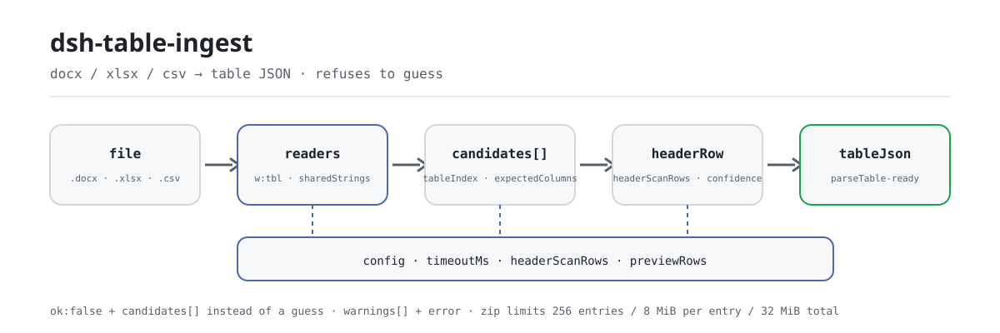

<div align="center">

<picture>
  <source media="(prefers-color-scheme: dark)" srcset="docs/assets/dsh-table-ingest-flow-dark.svg">
  
</picture>

# dsh-table-ingest

**Converte docx, xlsx e csv no JSON de tabela que um verificador de regras consegue consumir — e diz qual tabela escolheu e se tem certeza.**

Um conversor estrutural para o DeepSeek Harness: várias tabelas no mesmo Word, células mescladas, uma linha de título acima do cabeçalho — tudo isso vira nomes de coluna, linhas e um nível de confiança; e quando não consegue, ele diz, em vez de adivinhar.

[Instalar](#instalação-em-três-passos) · [Configuração](#configuração) · [FAQ](#faq) · [简体中文](README.md) · [English](README.en.md) · [Español](README.es.md) · [Português](README.pt.md) · [हिन्दी](README.hi.md)

[](LICENSE)
[](#compatibilidade)
[](https://www.npmjs.com/package/dsh-table-ingest)
[](https://github.com/PerryLink/dsh-table-ingest/actions/workflows/ci.yml)
[](#compatibilidade)

[](https://github.com/PerryLink/dsh-table-ingest/stargazers)
[](https://www.npmjs.com/package/dsh-table-ingest)
[](https://dshfind.com/plugins/PerryLink/dsh-table-ingest?ref=badge)
[](https://securityscorecards.dev/viewer/?uri=github.com/PerryLink/dsh-table-ingest)

```sh
dsh plugin --profile <name> add dsh-table-ingest
```

</div>

<sub>Plugin da comunidade, sem afiliação com a DeepSeek. Repositório canônico: <https://github.com/PerryLink/dsh-table-ingest>.</sub>

## O que é

O `dsh-table-ingest` converte arquivos `.docx`, `.xlsx`, `.xlsm`, `.csv` e `.tsv` no JSON de tabela que os verificadores de regras desta família consomem. Um verificador só consegue ler uma tabela que reconhece, e os documentos reais de escritório costumam ser arquivos Word com várias tabelas, células mescladas e uma linha de título acima do cabeçalho. Este pacote é esse passo — e, mais importante, **quando não consegue converter, ele diz isso em vez de adivinhar**.

Não emite julgamento de negócio: não decide se um documento cumpre, não atribui responsabilidade e não tem regras próprias; `rules/table-ingest.yaml` está vazio de propósito.

- **Para quem**: quem precisa levar material tabular para uma verificação de regras; não é preciso linha de comando, basta entregar o arquivo na conversa.
- **O que você entrega**: o caminho local de um arquivo `.docx` / `.xlsx` / `.xlsm` / `.csv` / `.tsv`. O original nunca é modificado.
- **O que ele devolve**: o JSON de tabela, os nomes de coluna e o tamanho com um nível de confiança, e uma tabela de prévia para o olho humano; quando não acha tabela, a lista de candidatas e o motivo.

## Instalação em três passos

1. **Instalar** (escolha um canal):

   ```sh
   # canal git (main mais recente; equivale a git+https://github.com/PerryLink/dsh-table-ingest.git)
   dsh plugin --profile <name> add github:PerryLink/dsh-table-ingest
   # canal npm (versões publicadas)
   dsh plugin --profile <name> add dsh-table-ingest
   # canal tarball: pnpm pack neste repositório e depois
   dsh plugin --profile <name> add ./dsh-table-ingest-<version>.tgz
   ```

2. **Configuração mínima** (os padrões já servem; uma linha de bundle sem `config` funciona com eles):

   ```yaml
   - insert:
       - id: dsh-table-ingest
         name: dsh-table-ingest
   ```

3. **Verificar que ficou ativo**:

   ```sh
   dsh --profile <name> --dump-config | grep 'dsh-table-ingest'
   ```

   Depois entregue um arquivo. Com a amostra incluída (rode antes `pnpm run build` para existir `lib/`) a execução imprime um resumo de quatro linhas, e o JSON completo que ela produz está reproduzido em [Exemplos](#exemplos).

   ```sh
   $ node samples/quickstart/run.mjs
   table_ingest: docx, ok, 4 rows x 3 columns, confidence medium
   ```

   *Observed from `docs/assets/quickstart.log`; `samples/quickstart/expected/result.json`*

**Desinstalar**: `dsh plugin --profile <name> remove dsh-table-ingest` (ou apague a linha do patch do profile).

## Capacidades principais

O `dsh-table-ingest` registra a ferramenta `table_ingest`: lê um arquivo, escolhe uma tabela, devolve o JSON de tabela que o verificador seguinte consegue consumir e declara a evidência de cada decisão.

- **Cinco formatos, um pipeline** — `.docx`, `.xlsx`, `.xlsm`, `.csv` e `.tsv` passam pelas mesmas etapas (escolher tabela → detectar cabeçalho → prévia → JSON de tabela). CSV/TSV aceitam aspas RFC 4180 e detecção de delimitador, e recorrem a GB18030 quando os bytes não são UTF-8 válido: a codificação comum dos CSV chineses exportados do Excel no Windows, em que uma decodificação UTF-8 direta transforma cada nome de coluna em caracteres de substituição.
- **Várias tabelas, sem adivinhar** — quando mais de uma tabela é igualmente plausível ele devolve as candidatas com o tamanho de cada uma e pede que você escolha com `tableIndex`; `expectedColumns` é o sinal mais forte e transforma um documento ambíguo em uma escolha determinística.
- **Detecção de cabeçalho com nível de confiança** — pontua negrito, sombreamento, `tblHeader`, texto curto, ausência de dígitos e um vocabulário pequeno nas primeiras `headerScanRows` linhas (6 por padrão), e rotula o resultado como `high` / `medium` / `low`; `low` significa «alguém deveria olhar».
- **Células mescladas preenchidas, não descartadas** — `w:gridSpan` expande na horizontal, `w:vMerge` (sem `w:val`) continua a célula de cima, uma tabela que continua em outra página é mesclada pelo cabeçalho e uma linha mesclada de largura total é ignorada como rótulo de grupo; cada um desses passos é informado em `warnings`.
- **Uma tabela errada custa mais do que nenhuma** — a prévia termina com «é esta a tabela que você queria?» e nunca diz «conversão concluída»; tabela inexistente, cabeçalho indetectável e contagem irregular de células aparecem em `error` e `warnings`.
- **Somente leitura e sem rede** — lê apenas o arquivo que você entrega, nunca o reescreve, é ESM puro e não faz requisição de rede nem chamada ao modelo.
- **Entrada de biblioteca** — `dsh-table-ingest/api` expõe a mesma conversão como funções comuns (`ingestToTable`, `readWorkbook`, `readDelimited`, `serialToDate`, …), então outro pacote não precisa do registro da ferramenta nem de uma segunda cópia dos leitores OOXML.

### O que ele responde

- Quais tabelas este documento realmente contém, e qual o tamanho de cada uma?
- Qual linha é o cabeçalho, e quais são os nomes de coluna?
- A tabela escolhida é confiável o bastante para rodar regras, ou alguém deveria confirmar antes?
- Se não há tabela utilizável, é porque o documento não tem, ou porque precisa de OCR?

### Superfície da ferramenta

Todos os argumentos de `table_ingest` são opcionais: deixá-los vazios significa «decida você e me diga o que decidiu», que é o caso comum; fornecer um substitui a heurística em vez de apenas incliná-la.

| Argumento | Tipo | Padrão | Significado |
|---|---|---|---|
| `file` | string | obrigatório | Caminho absoluto (`.docx` / `.xlsx` / `.xlsm` / `.csv` / `.tsv`) |
| `tableIndex` | number | vazio = automático | Qual tabela pegar (base 0); em ambiguidade devolve candidatas em vez de adivinhar |
| `headerRow` | number | vazio = sinal de diagramação | Qual linha é o cabeçalho (base 1) |
| `expectedColumns` | string[] | `[]` | Nomes de coluna esperados; sinal principal para escolher tabela e cabeçalho |
| `captionKeywords` | string[] | `[]` | Palavras que o título da tabela pode conter, por exemplo «diário de obra» ou «pontuação» |
| `previewRows` | number | `previewRows` da config | Quantas linhas de dados a prévia devolve |

### Campos de saída

| Campo | Significado |
|---|---|
| `ok` | Se foi possível identificar uma única tabela com confiança suficiente |
| `tableIndex`, `headerRow`, `columns` | O que foi escolhido |
| `rowCount`, `candidateCount` | Quanto foi lido e quantas tabelas foram encontradas |
| `confidence` | `high`, `medium` ou `low` — `low` significa «alguém deveria olhar» |
| `preview` | Uma tabela markdown com as primeiras linhas, para confirmar |
| `tableJson` | A tabela no formato que um verificador de regras aceita |
| `warnings`, `error` | O que estava estranho, ou por que nenhuma tabela foi escolhida |

A tabela escolhida sai no mesmo formato que o `parseTable` aceita, então um verificador consegue consumi-la diretamente.

### Exemplos

Estes são os pontos de entrada reais do plugin; instale uma vez e chame um.

**Exemplo detalhado** — ferramenta `table_ingest`, alvo `samples/quickstart/input/B-tender-multi-table.docx` (uma tabela de pontuação dividida em duas páginas); o texto completo de `samples/quickstart/expected/result.json`:

```json
{
  "tool": "table_ingest",
  "format": "docx",
  "ok": true,
  "confidence": "medium",
  "tableIndex": 0,
  "headerRow": 1,
  "columns": [
    "评审因素",
    "分值",
    "评分标准"
  ],
  "rowCount": 4,
  "candidateCount": 1,
  "warnings": [
    "与第 2 张表表头相同，已按跨页续表合并",
    "第 3 行是整行合并的分组行「服务部分」，已跳过（未作为数据行）",
    "第 2 张表与上一张表表头相同，已合并为一张"
  ]
}
```

Os três `warnings` dizem o que ele fez: uma continuação entre páginas foi mesclada pelo cabeçalho, uma linha de grupo mesclada de largura total foi ignorada como rótulo e duas tabelas com o mesmo cabeçalho viraram uma; nada disso acontece em silêncio.

*Observed from `samples/quickstart/expected/result.json`; `src/ingest/table-json.ts`*

**Ramo de falha** — a ferramenta `table_ingest` lendo `C-hedui-baogao.docx` (várias tabelas igualmente plausíveis): o resultado é `ok: false`, `error` nomeia `tableIndex`, `candidates` lista linhas e colunas de cada candidata, sua linha de cabeçalho e seu título, e o markdown termina pedindo que você nomeie uma delas com `tableIndex` e tente de novo. Se você fornecer `expectedColumns` com os nomes de coluna esperados, o mesmo documento é resolvido de forma determinística.

*Observed from `tests/index.test.ts:63-79`; `src/view.ts:84-100`*

**Exemplos curtos**: `node samples/quickstart/run.mjs --json` · `node samples/quickstart/run.mjs --check`

## O padrão que ele codifica

Este pacote não codifica nenhuma cláusula legal ou regulatória, por isso seu pacote de regras está vazio e não há diretório de evidências a citar. O que ele codifica é a estrutura OOXML de `word/document.xml` e `xl/worksheets/*.xml`:

- `<w:tbl>`, `<w:tr>`, `<w:tc>` para a estrutura da tabela; `<w:gridSpan>` para mesclagens horizontais e `<w:vMerge/>` (sem `w:val`) para «continuar a célula de cima» — esta última fica *vazia* no XML, então preenchê-la para baixo é obrigatório, ou um documento completo parece ter datas faltando.
- `<w:tblHeader>` junto com sombreamento e negrito como indícios de cabeçalho; o formato não define normativamente «linha de cabeçalho», então a detecção é uma heurística pontuada e o resultado é informado com um nível de confiança.
- `sharedStrings.xml` para cadeias compartilhadas (o `<v>` é um *índice*, não o valor), cadeias em linha (`t="inlineStr"`, cujo valor não está em `<v>`), e a indireção de três níveis `c@style` → `cellXfs` → `numFmtId` que decide se um número é data.

### O pacote de regras está vazio

Este pacote não cita cláusula alguma, por isso não tem diretório `rules/evidence/` e seu pacote de regras está vazio por decisão de projeto. Confirme com:

```sh
pnpm run check:citations   # espera 0 segments, 0 placeholders, 0 untraceable
```

O motivo de manter `rules/table-ingest.yaml` em vez de apagá-lo está escrito no cabeçalho do arquivo: a estrutura de pacotes da família dá a cada pacote um `rules/<pack>.yaml` que as ferramentas localizam, e manter regras separadas dos dados é o que permite que um pacote de regras posterior consuma a saída deste. Acrescentar aqui mais tarde uma regra de «estrutura do material» (por exemplo, «esta tabela precisa ter cabeçalho») significa ampliar esse arquivo no mesmo formato dos demais pacotes de regras.

## Formato do material

Um `.docx` com uma linha de título, uma linha de cabeçalho e duas linhas de dados:

```
序号 | 日期        | 施工部位   | 监理情况
1    | 2026-10-08  | 1#楼三层   | 旁站检查…
2    | 2026-10-08  | 1#楼三层   | 旁站全过程…
```

vira:

```json
{
  "target": "site-log.docx",
  "tableIndex": 0,
  "headerRows": [2],
  "columns": ["序号", "日期", "施工部位", "监理情况"],
  "header": {},
  "rows": [
    { "序号": "1", "日期": "2026-10-08", "施工部位": "1#楼三层", "监理情况": "旁站检查…" },
    { "序号": "2", "日期": "2026-10-08", "施工部位": "1#楼三层", "监理情况": "旁站全过程…" }
  ],
  "warnings": ["1 个单元格为空，已从上方合并单元格补值"],
  "mergedCells": 1,
  "sections": [],
  "ragged": false
}
```

`.csv` e `.tsv` produzem o mesmo formato com `headerRows: [1]`. Todos os valores permanecem como texto, então um zero à esquerda sobrevive.

## Configuração

Tudo o que é ajustável é um campo Schemastery `Config` em `src/config.ts` (sobrescrevível a partir do cordis.yml). Uma substituição por id troca a linha inteira: repita todas as chaves de que precisa. Este pacote é um conversor, não um verificador de regras, então não há chaves de ligar/desligar regras, apenas os tetos das heurísticas e o tempo limite da ferramenta:

| Chave | Tipo | Padrão | Significado |
|---|---|---|---|
| `timeoutMs` | number | `60000` | Orçamento de tempo limite da ferramenta (milissegundos) |
| `headerScanRows` | number | `6` | Quantas linhas para baixo são varridas para o cabeçalho; um cabeçalho mais abaixo é informado como «sem cabeçalho» |
| `previewRows` | number | `10` | Quantas linhas de dados a prévia de confirmação devolve por padrão |

Exemplo de substituição no patch do profile:

```yaml
- insert:
    - id: dsh-table-ingest
      name: dsh-table-ingest
      config:
        headerScanRows: 10
        previewRows: 20
        timeoutMs: 180000
```

## FAQ

<details>
<summary>Meu arquivo é enviado para algum lugar? Ele chama a internet?</summary>

Não. Ele lê apenas o arquivo local que você entrega, não faz requisição de rede, não chama modelo algum, nunca reescreve o original e não guarda uma segunda cópia (`package.json#dsh.demo` declara `network: false`, `writes: []` e uma única leitura: o .docx a extrair). O resultado existe somente no valor de retorno dessa chamada.

</details>

<details>
<summary>Com várias tabelas, ele vai escolher uma sem me avisar?</summary>

Não. Quando duas ou mais tabelas pontuam de forma parecida com os mesmos sinais, ele lista as candidatas com linhas e colunas e a posição do cabeçalho, coloca `ok` em `false` e pede que você nomeie uma com `tableIndex`; `expectedColumns` costuma resolver de primeira e é o argumento mais eficaz. A tabela que ele escolhe vem com uma prévia que termina com «é esta a tabela que você queria?», porque ele nunca afirma que a conversão deu certo.

</details>

<details>
<summary>Minha tabela tem uma linha de título acima do cabeçalho, ou o cabeçalho está bem no fundo. E aí?</summary>

A detecção de cabeçalho olha apenas as primeiras `headerScanRows` linhas (6 por padrão); o que estiver mais abaixo é informado como «sem cabeçalho» em vez de ser procurado indefinidamente. Isso é deliberado: tratar o corpo como cabeçalho faz todas as regras seguintes errarem. Para esses documentos, nomeie a linha com `headerRow` (base 1). Cabeçalhos de dois níveis também não são mesclados — o motivo está em «Limitações conhecidas».

</details>

<details>
<summary>Um docx hostil que me enviarem pode estourar a memória?</summary>

A partir da 0.2.1 há tetos rígidos: o pacote é rejeitado antes da descompressão quando declara mais de 256 entradas, nome de entrada acima de 4 KiB ou entrada comprimida acima de 8 MiB; a saída do deflate é limitada por entrada (8 MiB) e no total (32 MiB) via `inflateRawSync({ maxOutputLength })`, então um fluxo deflate válido mas hostil não pode expandir sem limite. São tetos de segurança, não opções ajustáveis.

</details>

<details>
<summary>Ele tem regras próprias? Pode julgar conformidade?</summary>

Não, e não. `rules` dentro de `rules/table-ingest.yaml` é um arranjo vazio: este pacote só converte estrutura e nunca produz achado, pontuação ou atribuição de responsabilidade. Para julgar conformidade, entregue o `tableJson` dele a um pacote de regras de verdade (os 62 verificadores da família).

</details>

## Resolução de problemas

- **O plugin instala, mas a ferramenta não aparece.** Confirme que `main` resolve para `lib/index.mjs` e que `pnpm run build` o produziu; um `main` errado faz o carregador ignorar a linha em silêncio.
- **`dsh plugin add` recusa o pacote como incompatível.** Aqui `engines.dsh` é `>=0.2.1-0 <0.3.0`, e a faixa de peers cobre `0.1.x` e `0.2.x`; fora dela, conceda uma isenção explícita.
- **A tabela voltou sem cabeçalho, ou escolheu claramente o cabeçalho errado.** Nomeie-o com `headerRow` (base 1) ou aumente `headerScanRows`; `confidence: low` é exatamente o sinal de «alguém deveria olhar».
- **Uma regra seguinte não rodou.** Leia o arranjo `skipped` daquele relatório: este pacote só entrega a tabela, as regras rodam no pacote seguinte; uma tabela mal lida faz o relatório seguinte mostrar diferenças que não existem, então confira primeiro `ok` e a prévia.
- **Um documento de quatro tabelas sempre acaba perguntando.** Passe `expectedColumns`; a ambiguidade vira escolha determinística.

## Limites de segurança

- **Tetos de ZIP** (desde 0.2.1). A entrada DOCX/XLSX não é confiável: o pacote é rejeitado antes da descompressão quando declara mais de 256 entradas, nome de entrada acima de 4 KiB ou entrada comprimida acima de 8 MiB; a saída do deflate é limitada por entrada (8 MiB) e no total (32 MiB).
- **Limites do diretório.** Comprimentos de nome, extra, comentário e cabeçalho local são verificados contra o buffer antes da leitura; um diretório truncado ou um deslocamento local fora do pacote lança `ZipError` em vez de devolver dados parciais.
- **Somente leitura.** Nunca reescreve o arquivo que leu nem cria cópia; nenhum estado é compartilhado entre chamadas (`isConcurrencySafe: () => true`).
- **A falha é visível.** Quando nenhuma tabela pode ser identificada o resultado é `ok: false` + `error` + a lista de candidatas, nunca uma tabela fabricada de uma coluna: «uma coluna de texto» não seria aceita por nenhum alias de coluna seguinte, então informar «nenhuma tabela encontrada» é a resposta honesta.
- **Sem julgamento de negócio.** Sem regras, sem pontuação, sem veredito de conformidade; `rules/table-ingest.yaml` é um pacote vazio e `check:citations` espera 0 segments / 0 placeholders / 0 untraceable.
- **Sem rede, sem chamada ao modelo, sem código nativo.** ESM puro, processamento puramente local de texto e bytes.

## Permissões e dados

- **Permissões**: o manifesto declara apenas `tools:register`; `package.json#dsh.demo` indica uma leitura (o .docx a extrair), nenhuma escrita e `network: false`.
- **Dados**: nada é gravado em disco, enviado ou duplicado; a conversão existe somente no valor de retorno daquela chamada.
- **Registro de sessão**: o texto do resultado é registrado na sessão pelo host (comportamento do host); este plugin não declara nem acrescenta nenhum tipo de evento de sessão próprio.
- **Privacidade**: [`PRIVACY.md`](PRIVACY.md) cobre o pacote npm em si, não o host DSH nem outros plugins do profile.

## Limitações conhecidas

- **A detecção de cabeçalho é heurística.** Ela pontua negrito, sombreamento, `tblHeader`, texto curto, ausência de dígitos e um vocabulário pequeno nas seis primeiras linhas. Um cabeçalho mais abaixo é informado como «sem cabeçalho» em vez de procurado indefinidamente.
- **Cabeçalhos de dois níveis não são mesclados por padrão.** Mesclá-los quebra a correspondência de alias posterior (uma coluna de valor intitulada `amount (yuan)/total` não é o alias `total`), então se usa a linha mais específica e o rótulo pai só é prefixado quando um nome filho se repete.
- **Tabela irregular é informada, não consertada.** Quando as células de uma linha não somam a largura declarada, o resultado é marcado `ragged` e com confiança `low`; não há informação no arquivo para recuperar a intenção do autor.
- **`expectedColumns` é o sinal mais forte que você pode dar.** Com ele, um documento ambíguo de quatro tabelas vira escolha determinística.
- **Não se lê `.doc` (BIFF), imagens digitalizadas nem PDF.** Isso exige um conversor ou OCR que esta família deliberadamente não carrega; os formatos binários `.doc` e `.xls` também ficam fora.
- **O pacote de regras está vazio.** Este pacote não cita cláusula alguma e não tem diretório `rules/evidence/`; veredito de conformidade não é o trabalho dele.

## Interoperabilidade com outros plugins DSH

- **Uma só ferramenta, registrada uma vez.** O id é `table_ingest`, com `inject: ['tools']`: sem um serviço `tools` o plugin não carrega, então ele nunca inicia pela metade.
- **Sem chave de serviço, sem slot, sem rota HTTP.** Não fornece chave de serviço, não registra chave de slot de cliente, não registra prefixo `webServer` e não remenda protótipos, não reescreve `process.env` nem substitui o despachante global de fetch.
- **O patch do bundle apenas `insert`a a própria linha.** `cordis.patch.yml` nunca sobrescreve o `config` de uma linha embutida, então não colide com outro plugin que também faça patch.
- **Registro é efeito.** `ctx.tools.register` devolve o liberador, então recarga a quente e descarga removem a ferramenta.
- **A saída encaixa no consumidor.** O JSON de tabela tem o formato que o `parseTable` aceita, e um teste afirma «produces table JSON the engine can consume», então os pacotes de regras da família o consomem direto, sem adaptador.

## Compatibilidade

| Superfície | Estado |
|---|---|
| Harness | `engines.dsh` é `>=0.2.1-0 <0.3.0`; faixa de peers `>=0.1.2-rc.1 <0.2.0 \|\| >=0.2.0-0 <0.3.0` (cobre as linhas 0.1.x e 0.2.x) |
| Node | `^22.19.0 \|\| >=24.0.0` |
| Plataformas | Todas (ESM puro; sem código nativo, sem rede, sem chamada ao modelo) |
| Formatos de entrada | `.docx`, `.xlsx`, `.xlsm`, `.csv`, `.tsv`; sem `.doc` (BIFF), sem digitalizações, sem PDF |

## Ecossistema e qualidade

- [Página do pacote npm](https://www.npmjs.com/package/dsh-table-ingest) (versão, downloads, dependências)
- [Página no dshfind](https://dshfind.com/plugins/PerryLink/dsh-table-ingest) (instalações e classificação)
- [Relatório OpenSSF Scorecard](https://securityscorecards.dev/viewer/?uri=github.com/PerryLink/dsh-table-ingest) (movido por [.github/workflows/scorecard.yml](.github/workflows/scorecard.yml))
- [Escolha um verificador por material](https://perrylink.github.io/zh/checkers/choose/) (o índice completo dos 62 verificadores; este pacote é a camada acima deles)
- [Base de conhecimento do ecossistema](https://perrylink.github.io/dsh-plugin-guide/): guia de desenvolvimento de plugins · dados de seleção · critérios de manutenção
- [Todos os plugins da PerryLink](https://github.com/PerryLink) (visão geral da família)

## Desenvolvimento

```sh
pnpm install                                       # node ^22.19 || >=24
pnpm run typecheck                                 # tsc --noEmit
pnpm test                                          # vitest run: contrato + semântica de limites + tetos ZIP
pnpm run build                                     # tsdown -> lib/index.mjs + lib/index.d.mts
pnpm run verify:self-contained                     # dependências resolvem do registry
pnpm run check:lockfile                            # verificação de deriva do lockfile
pnpm run check:readmes                             # consistência dos README em cinco idiomas
pnpm run check:citations                           # linha de base de citações do pacote de regras
node ../scripts/sync-shared.mjs dsh-table-ingest   # atualizar src/shared a partir de ../_shared
pnpm pack                                          # o tarball publicado
```

O registro de aceitação está em [`ACCEPTANCE.csv`](ACCEPTANCE.csv) (`npx vitest run`, 25/25 passando, origem public/synthetic). A execução da amostra precisa de `pnpm run build` antes:

```sh
node samples/quickstart/run.mjs           # resumo legível
node samples/quickstart/run.mjs --json    # o mesmo resumo em JSON
node samples/quickstart/run.mjs --check   # comparar com expected/result.json
```

A entrada da amostra está em `samples/quickstart/input/` e a saída de referência em `samples/quickstart/expected/result.json`; a captura real e o texto de terminal são `docs/assets/quickstart.png` e `docs/assets/quickstart.log`.

Estrutura de diretórios:

| Caminho | Conteúdo |
|---|---|
| `src/index.ts` | Entrada do plugin: `name` / `inject` / `Config` / `apply`, registra `table_ingest` |
| `src/config.ts` | Esquema Schemastery (todo ajustável vive aqui) |
| `src/ingest/` | Leitores de formato: `docx.ts`, `xlsx.ts`, `csv.ts`, `zip.ts`, `xml.ts`, mais o pipeline de seleção e cabeçalho `ingest.ts`, `table-json.ts` |
| `src/view.ts` | Projeção para o modelo: o resumo `markdown`, a prévia e a redação das candidatas |
| `src/api.ts` | Entrada de biblioteca `dsh-table-ingest/api` |
| `src/shared/` | Kit compartilhado copiado (tabelas, ruleset, subconjunto YAML, aritmética de datas, guarda de redação) |
| `rules/table-ingest.yaml` | O pacote de regras vazio (convenção estrutural, ver «O pacote de regras está vazio») |
| `tests/` | vitest: contrato, semântica de limites, tetos ZIP; `fixtures/` com docx/xlsx/csv sintéticos reais |
| `samples/quickstart/` | Amostra reexecutável e sua saída de referência |
| `docs/assets/` | Imagens e a saída real de terminal |

As imagens do README são geradas por programa por [`scripts/gen-readme-assets.py`](scripts/gen-readme-assets.py) (SVG puro, texto com tokens de comando, variantes clara e escura) e podem ser reexecutadas: `python scripts/gen-readme-assets.py`. O diagrama e a demo de versão única continuam em `docs/assets/` para links externos; os README referenciam apenas o par novo.

Topics: `deepseek-harness`, `dsh`, `dsh-plugin`, `cordis`, `ingest`, `docx`, `xlsx`, `csv`, `table`

## Família e agradecimentos

Este projeto faz parte da família de plugins do DeepSeek Harness da [PerryLink](https://github.com/PerryLink) (todos Apache-2.0). O índice completo é [escolha um verificador por material](https://perrylink.github.io/zh/checkers/choose/); este pacote é a camada de conversão acima desses 62 verificadores. Se ele for útil, **uma estrela ajuda a próxima pessoa a encontrá-lo** — nada fica bloqueado por isso.

- [@PerryLink](https://github.com/PerryLink) — criador e mantenedor: os leitores OOXML e de delimitados, as heurísticas de seleção de tabela e cabeçalho, a ferramenta `table_ingest`, a entrada de biblioteca `dsh-table-ingest/api` e a documentação em cinco idiomas.

## Licença

[LICENSE](LICENSE) (Apache License 2.0) © 2026 dsh-table-ingest contributors

<p align="center"><sub>Apache-2.0 · plugin da comunidade, sem afiliação com a DeepSeek.</sub></p>
